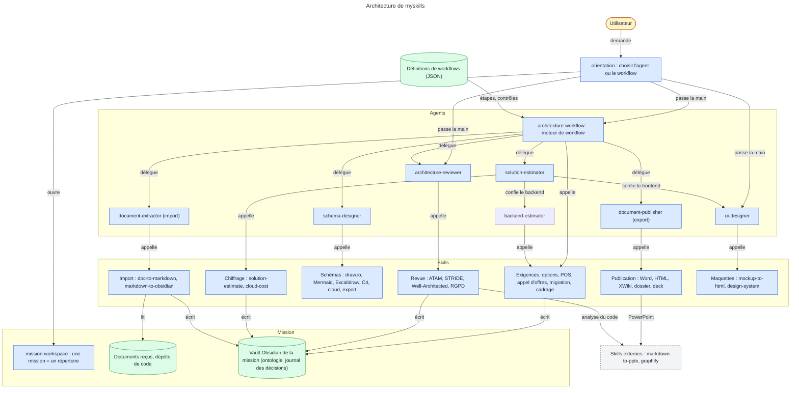

# myskills

Plugin de skills et d'agents pour l'ingénierie logicielle, utilisable dans
**GitHub Copilot**, **Claude Code**, **Kiro**, **OpenCode** et **Hermes** :

- **Extraction documentaire** : PDF, DOCX, PPTX, XLSX, images vers Markdown ou
  Obsidian.
- **Schémas** : draw.io, Excalidraw, C4, Mermaid, plan d'occupation des sols du SI, adaptés à un public
  technique ou non, pour Markdown, Office et Confluence.
- **Publication** : Markdown vers Word, HTML ou XWiki, schémas compris.
- **Des documents à l'architecture** : exigences fonctionnelles et non
  fonctionnelles tracées jusqu'aux sources, 2 ou 3 architectures comparées,
  schémas, avec une revue humaine à chaque étape, un journal des décisions et
  une mémoire partagée dans le vault Obsidian.
- **Avant-vente** : une mission par répertoire, dépouillement de l'appel
  d'offres, matrice de conformité, chiffrage, registre des hypothèses et
  questions au client, mémoire technique dans l'ordre des critères de
  notation.
- **Maquettes et design system** : maquettes d'écrans en image reproduites
  en HTML/CSS accessible (ou Bootstrap, React MUI ou Ant Design, Vue Vuetify, Angular Material), rendues en
  local et comparées à la maquette ; design system tiré des maquettes
  (tokens, contrastes WCAG, styleguide) ; découpage en composants et
  chiffrage frontend.

## Installation

| Outil | Commande |
| --- | --- |
| GitHub Copilot CLI | `copilot plugin marketplace add RenaudVanhille/myskills` puis `copilot plugin install myskills@myskills` |
| Claude Code | `/plugin marketplace add RenaudVanhille/myskills` puis `/plugin install myskills@myskills` |
| Kiro | Panneau Powers > Add Custom Power > Import power from GitHub > `https://github.com/RenaudVanhille/myskills` (skills uniquement) |
| OpenCode | Pas d'installation native : `uv run scripts/install.py --tools opencode [--global]` |
| Agents Kiro | Les powers ne transportent pas d'agents : `uv run scripts/install.py --tools kiro [--global]` |
| Hermes | Skills : `hermes skills tap add RenaudVanhille/myskills` puis `hermes skills install RenaudVanhille/myskills/skills/<skill>`. Tout, agents compris : `uv run scripts/install.py --tools hermes [--global]` |

Hermes n'a pas d'agents personnalisés : `install.py` y installe
les agents (`schema-designer`, `document-extractor`, `document-publisher`,
`architecture-workflow`) sous
forme de skills. Hermes ne lit que `~/.hermes/skills` : en projet, `install.py`
affiche la commande `hermes config set skills.external_dirs "<dossier>"` à
lancer une fois (elle remplace les `external_dirs` déjà configurés).

### Synchronisation depuis GitHub

`install.py sync` installe et met à jour skills et agents pour les cinq
outils d'un coup. Installation **globale** par défaut, conseillée : les
skills ne dépendent d'aucun projet. Le dépôt étant privé, il faut l'une des
quatre voies ci-dessous pour la première fois ; ensuite,
`uv run ~/.myskills/install.py sync` met à jour (rien n'est réécrit si la
version n'a pas changé) et `uv run ~/.myskills/install.py status` dit ce
qui est installé et si GitHub a plus récent.

**1. Archive ZIP, sans jeton ni outil.** Sur la page du dépôt, connecté à
GitHub : Code > Download ZIP. Décompressez-la, puis :

```bash
uv run myskills-main/scripts/install.py sync --source myskills-main --tools claude,copilot
```

Pour mettre à jour, téléchargez un nouveau ZIP et passez-le tel quel :
`uv run ~/.myskills/install.py sync --source ~/Downloads/myskills-main.zip`.

**2. Jeton GitHub, sans gh.** Créez un jeton *fine-grained* (GitHub >
Settings > Developer settings > Personal access tokens), limité au dépôt
`myskills` avec la permission *Contents : Read-only*. Téléchargez le script
avec ce jeton :

```powershell
# PowerShell
$env:MYSKILLS_TOKEN = "github_pat_..."
Invoke-WebRequest https://api.github.com/repos/RenaudVanhille/myskills/contents/scripts/install.py `
  -Headers @{Authorization = "Bearer $env:MYSKILLS_TOKEN"; Accept = "application/vnd.github.raw"} -OutFile install.py
uv run install.py sync --tools claude,copilot
```

```bash
# bash, zsh
export MYSKILLS_TOKEN=github_pat_...
curl -fsSL -H "Authorization: Bearer $MYSKILLS_TOKEN" -H "Accept: application/vnd.github.raw" \
  -o install.py https://api.github.com/repos/RenaudVanhille/myskills/contents/scripts/install.py
uv run install.py sync --tools claude,copilot
```

Le script lit `MYSKILLS_TOKEN` (ou `GH_TOKEN`, `GITHUB_TOKEN`) ; sans
variable ni gh, il demande le jeton dans le terminal, saisie masquée, sans
l'enregistrer. Pour le garder : `setx MYSKILLS_TOKEN github_pat_...` sous
Windows, une ligne `export` dans le profil du shell ailleurs.

**3. Clone git.** Git pour Windows ouvre le navigateur pour se connecter à
GitHub au premier clone (Git Credential Manager) :

```bash
git clone https://github.com/RenaudVanhille/myskills
uv run myskills/scripts/install.py sync --source myskills --tools claude,copilot
```

Pour mettre à jour : `git -C myskills pull`, puis `uv run ~/.myskills/install.py sync`
(la synchro reprend le dossier source de la précédente).

**4. GitHub CLI.** Avec `gh auth login` fait, aucun jeton à gérer :

```bash
gh api repos/RenaudVanhille/myskills/contents/scripts/install.py -H "Accept: application/vnd.github.raw" > install.py
uv run install.py sync --tools claude,copilot
```

En PowerShell, remplacez `> install.py` par `| Set-Content -Encoding utf8 install.py`.

| Option | Effet |
| --- | --- |
| `--global` (défaut) ou `--project DIR` | Dossier personnel, ou projet (version figée pour un client, prioritaire sur la globale) |
| `--tools claude,copilot,opencode,kiro,hermes` | Outils ciblés ; par défaut ceux de la synchro précédente, sinon ceux détectés |
| `--ref BRANCHE`, `--repo OWNER/NOM` | Version à installer (défaut : `main`) |
| `--source DIR` ou `--source FICHIER.zip` | Copie locale du dépôt (dossier, clone, ZIP de GitHub), sans téléchargement |
| `--models FICHIER` | Modèles de l'abonnement (voir plus bas), gardés pour les synchros suivantes |
| `--force`, `--dry-run` | Réinstaller même sans changement ; tout calculer sans rien écrire |

Dossiers : Claude Code `~/.claude/skills` et `~/.claude/agents` ; Copilot
`~/.copilot/skills` et `~/.copilot/agents` (en projet `.github/agents`, les
skills étant lus dans `.claude/skills` si Claude est ciblé) ; OpenCode
`~/.config/opencode` ; Kiro `~/.kiro` ; Hermes `~/.hermes/skills`. L'état
(version, outils, fichiers installés) est dans `~/.myskills/state.json` ou
`<projet>/.myskills.json` : une synchro retire ce qu'elle avait installé et
qui n'existe plus, et rien d'autre. Choisissez le plugin **ou** `sync` pour
Claude Code et Copilot, pas les deux : les skills apparaîtraient en double.

Les scripts sont en Python 3.10+ et fonctionnent sous Windows, macOS et
Linux. Lancez-les avec [uv](https://docs.astral.sh/uv/) (`uv run scripts/...`) :
uv installe les dépendances déclarées en tête de chaque script (MarkItDown,
Playwright, Pandoc...). Ceux qui n'en ont pas tournent aussi avec `python`.

### Prérequis par usage

Seul [uv](https://docs.astral.sh/uv/) est indispensable partout (sous Windows :
`winget install astral-sh.uv`). Le reste dépend de ce que vous faites. Les
bibliothèques Python (MarkItDown, Docling, Pandoc, Playwright, PyAV,
faster-whisper...) sont fournies par uv au premier lancement : il
n'y a rien à installer pour elles. La colonne « Vérifier » lance le skill
`check-prerequisites` (`uv run skills/check-prerequisites/scripts/doctor.py GROUPE`),
qui dit ce qui manque et donne la commande d'installation.

| Usage | À installer | Facultatif | Vérifier |
| --- | --- | --- | --- |
| Traiter des documents Office (DOCX, PPTX, XLSX, Outlook) | rien de plus | — | `extraction` |
| Traiter des PDF | les modèles de Docling, une fois : `doctor.py extraction --prefetch` (sans eux, MarkItDown seul) | Tesseract, pour l'OCR local des PDF scannés : `winget install UB-Mannheim.TesseractOCR` (macOS `brew install tesseract tesseract-lang`, Linux `apt install tesseract-ocr tesseract-ocr-fra`) ; sans lui, les pages scannées passent à la vision du modèle | `extraction` |
| Images (captures, photos de tableau blanc) | rien : lues par la vision du modèle | — | — |
| Trier un lot de documents (modèle local Laya) | le modèle Laya, une fois : `doctor.py extraction --prefetch` (sans lui, tri par règles) | — | `extraction` |
| Vidéo ou audio (atelier, kick-off, réunion, présentation) | le modèle de transcription, une fois : `doctor.py video --prefetch` (sur une machine sans accès à la source : `--models-from DOSSIER`) | — | `video` |
| Schémas draw.io, POS du SI, cloud (`.drawio` et `.drawio.png`) | [draw.io Desktop](https://github.com/jgraph/drawio-desktop/releases) (`winget install JGraph.Draw`) et un navigateur : Edge suffit sous Windows, sinon `uvx playwright install chromium` | — | `schemas` |
| Schémas Mermaid, Excalidraw | un navigateur (voir ci-dessus) | `doctor.py schemas --prefetch` pour travailler hors ligne | `schemas` |
| Schémas C4 (LikeC4) | [Node.js](https://nodejs.org/) (`winget install OpenJS.NodeJS.LTS`) | `npm install -g likec4`, plus rapide et nécessaire hors ligne | `schemas` |
| Publier en Word, HTML, XWiki | rien de plus (Pandoc est fourni) | [LibreOffice](https://www.libreoffice.org/download/), pour le PDF et la relecture visuelle des `.docx` | `publication` |
| Publier en PowerPoint | le skill externe `markdown-to-pptx` | — | `publication` |
| Maquettes vers HTML, design system | un navigateur (voir schémas) | Tesseract (textes des maquettes : ébauche et comparaison) ; Bootstrap dans le cache pour travailler hors ligne : `doctor.py maquettes --prefetch` | `maquettes` |
| Revue d'architecture avec comparaison au code | rien de plus | le skill externe `graphify` (analyse locale du code) | `revue` |
| Avant-vente, exigences, chiffrage, revues, matrices Excel | rien de plus | — | — |

`doctor.py` sans groupe vérifie tout. Rien ne s'installe sans votre accord :
le script donne seulement les commandes.

### Modèles et téléchargements

Un run ne doit rien télécharger : tout ce qui suit s'installe à l'avance,
une fois, sur une machine connectée. Les modèles se copient ensuite comme des
dossiers sur une machine sans réseau. Pendant un run, un script lit ses
modèles dans le cache vérifié et n'en télécharge aucun ; s'il en manque un,
il se replie (MarkItDown, règles) ou s'arrête, en donnant la commande
ci-dessous. De plus, il filtre ses flux réseau : seuls les hôtes de
`shared/model-sources.json` sont joignables, tout autre flux est refusé et
signalé dans le rapport.

| Élément | Taille | Source | Installer à l'avance | Pendant le run |
| --- | --- | --- | --- | --- |
| Modèle de transcription `whisper-small` (vidéo, audio) | ~480 Mo | Hugging Face `Systran/faster-whisper-small`, commit et SHA-256 épinglés dans `model-sources.json` | `doctor.py video --prefetch`, ou `--models-from DOSSIER` depuis une copie | lu dans le cache seulement ; sans modèle, images clés sans transcription |
| Modèles Docling : mise en page (`docling-layout-heron`) et tableaux (`docling-tableformer`) | ~0,4 Go | Hugging Face, dépôts de `docling-project`, commit et SHA-256 épinglés pour Docling 2.144.0 (version épinglée elle aussi) | `doctor.py extraction --prefetch`, ou `--models-from DOSSIER` | lus dans le cache seulement (`--artifacts-path`, Hugging Face hors ligne) ; sans eux, MarkItDown et un avertissement |
| Modèle Laya, checkpoints anglais et multilingue (tri des documents, exigences, routage) | ~1,5 Go | Hugging Face `convaiinnovations/laya`, révision relue par le paquet `laya`, SHA-256 épinglés | `doctor.py extraction --prefetch`, ou `--models-from DOSSIER` | lu dans le cache seulement ; sans lui, tri par règles et un avertissement |
| Langues Tesseract `fra` et `eng` | ~30 Mo | paquet système | avec Tesseract (tableau ci-dessus) | rien |
| Bibliothèques Python, Docling (~2 Go), Pandoc | — | PyPI, par uv | lancer une fois chaque script utile, connecté (`uv run SCRIPT --help`) | lues dans le cache de uv |
| Navigateur pour les rendus (schémas, pages HTML des maquettes) | ~150 Mo | Edge déjà installé, sinon Playwright | `uvx playwright install chromium` | réseau coupé ; les pages n'utilisent que les polices installées sur le poste |
| Mermaid et Excalidraw | ~5 Mo | npm, version et SHA-512 épinglées | `doctor.py schemas --prefetch` | avec `MYSKILLS_OFFLINE=1`, rien n'est téléchargé |
| Bootstrap (pages `--target bootstrap`) | ~1 Mo | npm, version et SHA-512 épinglées | `doctor.py maquettes --prefetch` | avec `MYSKILLS_OFFLINE=1`, rien n'est téléchargé |
| LikeC4 | ~100 Mo | npm | `npm install -g likec4` | sinon téléchargé par `npx` |

Pour un poste sans réseau : préparez un poste connecté
(`doctor.py tout --prefetch`, puis un premier lancement de chaque script
utile pour le cache de uv), copiez le cache de myskills
(`%LOCALAPPDATA%\myskills`, sinon `~/.cache/myskills`) et celui de uv, puis
`doctor.py tout --models-from <copie>/models` sur le poste cible.
`MYSKILLS_OFFLINE=1` et `UV_OFFLINE=1` y interdisent ensuite tout
téléchargement.

## Contenu

Un répertoire = une mission : `mission.py init DOSSIER --nature avant-vente|revue --name NOM`
(skill `mission-workspace`) crée `mission.json`, `documents/`, le vault de la mission
(et `code/` pour une revue) et démarre le workflow de sa nature ; l'agent `orientation`
le fait au démarrage. Les skills restent
installés une fois pour toutes ; seules les données vivent dans la mission.

### Architecture

L'agent `orientation` reçoit la demande, ouvre la mission et passe la main.
Le moteur `architecture-workflow` suit une définition JSON
(`skills/decision-log/workflows/`) et délègue chaque étape à l'agent
spécialisé. Les agents orchestrent et valident ; les skills font le travail
par leurs scripts. Le vault Obsidian de la mission sert de mémoire partagée
entre les étapes et les agents. Chaque passage de main est un message JSON
validé (skill `agent-handoff`).



### Agents

| Agent | Rôle |
| --- | --- |
| `orientation` | Point d'entrée quand on ne sait pas par où commencer : ouvre la mission au démarrage d'une avant-vente ou d'une revue d'architecture (`mission.py init`), choisit l'agent ou le workflow (liste compacte de `route.py`) et lui passe la main par un message validé, sans travail métier, une question au plus |
| `schema-designer` | Choisit le format de schéma selon le contexte, le public et la destination, puis valide le rendu |
| `document-extractor` | Import : convertit PDF, Office, images et vidéos (ateliers, réunions, présentations) en Markdown ou Obsidian, puis valide le Markdown |
| `document-publisher` | Export : transforme un Markdown en Word, PowerPoint, HTML ou XWiki pour SharePoint, Confluence ou XWiki, puis relit le rendu |
| `architecture-workflow` | Moteur de workflow générique : suit une définition JSON (par défaut `architecture` : documents, exigences avec glossaire, au choix domaines et style d'architecture (monolithe modulaire ou microservices), 2 ou 3 architectures situées dans le POS du SI, schémas et matrice de traçabilité, puis au choix revue, chiffrage et dossier d'architecture technique ; aussi `cloud-existant` : code d'infrastructure vers schéma cloud, menaces et revue Well-Architected ; `revue-dossier` : instruction d'un dossier reçu jusqu'à l'avis d'architecture ; `conformite` : menaces, hébergement, registre et AIPD RGPD, plan d'actions ; `migration-cloud` : évaluation 6R, cible, feuille de route ; `avant-vente`, celui d'une mission d'avant-vente : dépouillement de l'appel d'offres en parallèle des exigences, options, matrice de conformité, chiffrage et revue en parallèle, registre des hypothèses et questions au client, mémoire technique, soutenance, avec des étapes domaines et maquettes facultatives ; `maquettes` : design system, pages HTML comparées aux maquettes, revue UX, découpage et lots du chiffrage frontend ; `cadrage` : comptes rendus des ateliers, exigences, domaines facultatifs, options et modèle de données par contexte en parallèle, puis dimensionnement, interfaces avec leurs séquences et plan de recette) ; s'arrête après chaque étape pour la revue de l'utilisateur et trace chaque choix et décision |
| `architecture-reviewer` | Revue d'une architecture logicielle ou solution (ATAM : scénarios de qualité, risques, compromis, traçabilité, code comparé à l'architecture, avis calculé) et d'une architecture cloud : modèle de menaces STRIDE relu et revue Well-Architected des piliers, constats ouverts ou acceptés avec leur raison ; registre des traitements et AIPD RGPD |
| `ui-designer` | Agent UX/UI : maquettes d'écrans en image (appel d'offres, cahier des charges) reproduites en HTML/CSS et design system : palette et échelles mesurées sur les maquettes, tokens contrôlés, une page par écran ébauchée depuis les mesures de sa maquette, rendue en local et comparée bloc par bloc (sous-agents de niveau moyen en parallèle), revue UX et accessibilité (contrôles WCAG sur le rendu, heuristiques de Nielsen, parcours), en HTML, Bootstrap, React MUI ou Ant Design, Vue, Angular, documentation et styleguide ; découpage en composants et lots du chiffrage frontend |
| `solution-estimator` | Chiffrage de la solution retenue à partir des exigences et de l'architecture : orchestre les experts du frontend (`ui-designer`) et du backend (`backend-estimator`) en parallèle, fusionne leurs lots, estime le reste à trois points, hypothèses d'infrastructure et de run, charge, fourchette, réemploi, coût total et budget calculés par script, comparés en trois hypothèses (sans IA, avec IA, dev IA natif), puis fait challenger le chiffrage (marges cumulées, lots gonflés ou semblables) |
| `backend-estimator` | Expert du chiffrage backend (niveau moyen) : interfaces décrites si besoin, lots par ressource, opération, événement et intégration tirés d'abaques (ceux de l'utilisateur ou de la mission, sinon par défaut à calibrer), réemploi entre fonctionnalités déclaré, lots rendus à `solution-estimator` |

Chaque skill et chaque agent a un **contrat d'interface en JSON**, qui fait
foi :

- `skills/<nom>/contract.json` : entrées, sorties, scripts, options, codes de
  sortie, passages de main, et le **JSON Schema** du rapport de chaque script ;
- `src/agents/<nom>.contract.json` : ce que l'agent reçoit, produit, ne fait
  jamais, et à qui il passe la main avec quoi ;
- `shared/schemas/` : les schémas des contrats, du **message de passage**
  entre agents (`handoff.schema.json`) et du **rapport final** des agents
  (`agent-report.schema.json`), que les agents écrivent en JSON.

`scripts/build.py` en génère la section « Contrat » des SKILL.md et des
agents, [`CATALOG.md`](CATALOG.md) et [`catalog.json`](catalog.json), à
lire par un autre agent ou outil qui appelle myskills.

### Skills

| Skill | Rôle |
| --- | --- |
| `mission-workspace` | Espace de travail par mission : un répertoire, un vault Obsidian unique, pour une avant-vente (documents reçus) ou une revue d'architecture (documentation et code, un dépôt par service) ; ouvre la mission et démarre le workflow de sa nature, déclare les dépôts et fige leurs commits, fait le point dans le vault, contrôle la cohérence entre livrables sans modèle (`mission.py`) ; principes d'architecture du client et missions passées comparables (`analogues`) déclarés une fois ; les scripts du vault trouvent seuls le vault de la mission et refusent tout autre |
| `check-prerequisites` | Vérifie les outils locaux et indique comment installer les manquants ; prépare le mode hors ligne (`--prefetch`, empreintes vérifiées), y compris les modèles locaux depuis leur source épinglée |
| `doc-to-markdown` | Document vers Markdown (MarkItDown, Docling avec OCR Tesseract, vision) ; vidéo ou audio en images clés et transcription Whisper locale, flux réseau limités aux hôtes identifiés ; tri optionnel par type et domaine avec le modèle local Laya |
| `markdown-to-obsidian` | Markdown vers format Obsidian, vérification d'un vault contre l'ontologie commune et export de son graphe typé (`vault_check.py`) |
| `diagram-brief` | Choix du format de schéma : décision courte en JSON validée, format, skill et livraison selon le public et la destination (`brief.py`) |
| `drawio-diagram` | Schémas draw.io et exports ; un `.drawio` existant redevient une description courte à éditer (`drawio_read.py`) ; lisibilité estimée sans rendu (libellés trop longs, flèches croisées ou sous une forme) : l'image n'est relue que si elle est douteuse |
| `excalidraw-diagram` | Schémas Excalidraw pour publics non techniques |
| `c4-architecture` | Modèle C4 en LikeC4 écrit par script depuis un JSON court ou une option d'architecture |
| `urbanization-map` | Plan d'occupation des sols du SI (zones, quartiers, îlots, applications) en draw.io, depuis une description courte, un inventaire CSV ou une note Markdown ; options d'architecture situées dans le POS (impacts, redondances, POS cible, `pos_impact.py`) |
| `mermaid-diagram` | Schémas Mermaid dans le Markdown (flux et séquence écrits par script) |
| `requirements-catalog` | Catalogue des exigences fonctionnelles et non fonctionnelles, citations des sources vérifiées, phrases d'exigence oubliées signalées (tri par un sous-agent léger, ou regex et Laya en local), brouillon tiré des sources par script (`--draft` : le modèle relit au lieu d'écrire), glossaire relié aux exigences, export Markdown et CSV |
| `architecture-options` | 2 ou 3 options d'architecture : écarts aux exigences, score pondéré et rang calculés, recommandation, ADR, matrice de traçabilité, un schéma draw.io par option (et sa description cloud), position de chaque option dans le POS du SI (avec `urbanization-map`), revue Well-Architected des piliers de chaque option cloud (avec `well-architected-review`) |
| `solution-estimate` | Chiffrage d'une option d'architecture : charge par lot, phase et profil (estimation à trois points, fourchette P10-P90), pilotage et provision, infrastructure par hébergeur (dont OVHcloud, Cloud Temple, Outscale, S3NS) avec contrôle des qualifications exigées (SecNumCloud, HDS), maintenance et exploitation, coût total sur plusieurs années, budget, trois hypothèses de production comparées (sans IA, avec IA, dev IA natif : facteurs par phase, incertitude sur le gain, adoption, licences et jetons), plan de charge par tâche en jours et heures avec sa complexité (seul, sans taux journaliers), brouillon tiré de l'option (lots par composant et transverses, budget, infrastructure : le modèle n'écrit que les charges), exigences et composants non chiffrés et postes attendus absents signalés (règles de complétude, complétées par l'utilisateur et la mission), CSV pour un tableur (`estimate_build.py`) ; lots des experts frontend et backend fusionnés (`--lots`), réemploi déclaré par lot et taux de réemploi, points à challenger (marges cumulées, part de la réalisation, lots trop gros ou semblables sans réemploi, jours par exigence) avec les seuils des abaques de l'utilisateur ou de la mission (`~/.myskills/abaques.json`, `references.abaques`) ; calibration par analogie avec les missions passées désignées (parts de charge par phase) |
| `cloud-cost` | Coût de fonctionnement cloud des options d'architecture : consommations par option (calcul, conteneurs, base de données, stockage, réseau, journaux), plages horaires, remise d'engagement, production et hors production, calculés sur une grille de prix locale ou des prix propres ; options classées, prix à vérifier, hors production allumé en continu et postes oubliés signalés, lignes d'infrastructure du chiffrage (`cost_build.py`) |
| `data-protection` | Protection des données (RGPD) : registre des traitements (art. 30) et analyse d'impact (AIPD) depuis une description courte ; critères du CEPD, transferts hors EEE, hébergeur extraterritorial, risques cotés et reliés aux exigences et aux menaces, sources, impacts et mesures proposés par le script (`--draft`), notes du vault (`dpia_build.py`) |
| `migration-assessment` | Évaluation 6R d'un portefeuille d'applications (réhéberger, replateformer, refondre, racheter, retirer, conserver) : dépendances, retraits, obsolescence et hébergeur cible contrôlés, vagues de migration calculées (`assess_build.py`) |
| `transition-roadmap` | Feuille de route de transition : chantiers, jalons et vagues de migration, dates, marges et chemin critique calculés, échéance contrôlée, diagramme de Gantt Mermaid (`roadmap_build.py`) |
| `architecture-dossier` | Dossier d'architecture technique (DAT), avis d'architecture ou mémoire technique assemblé par script depuis les livrables validés d'un workflow, selon un gabarit de sections ; pièces manquantes signalées, liens et images vérifiés ; mémoire dans l'ordre des critères de notation, chaque critère couvert, budget de pages tenu (`dossier_build.py --tender`) ; plan d'actions unique, dédoublonné et priorisé, tiré des revues, CSV importable dans Jira ou Azure DevOps (`actions.py`) |
| `tender-response` | Réponse à un appel d'offres : dépouillement du dossier de consultation (dates limites et jours restants, critères et poids contrôlés, pièces à fournir, format, clauses à risque notées, citations vérifiées, `tender_build.py`), matrice de conformité exigence par exigence tirée des écarts de l'option, en Markdown, CSV et Excel (`compliance_build.py`), registre des hypothèses, exclusions, prérequis et questions au client avant la date limite (`assumptions.py`), qualification go / no-go sur une grille pondérée, note et recommandation calculées, décision tracée au journal (`qualify.py`) ; brouillons écrits par script (`--draft`) |
| `api-contract` | Contrats d'interface OpenAPI 3.1 et AsyncAPI 3.0 écrits par script depuis une description courte : doublons, types, exigences et composants de l'option contrôlés, exigence sans interface signalée, YAML relu (`api_build.py`) ; découpage du backend en lots de chiffrage à trois points (ressources, opérations, événements, intégrations, transverses) avec le réemploi déduit et les abaques fournis avant le lancement (`api_breakdown.py`) ; un diagramme de séquence Mermaid par exigence portée par les interfaces, libellés des composants de l'option, appels, réponses et événements asynchrones (`api_sequences.py`) |
| `meeting-notes` | Compte rendu de réunion ou d'atelier écrit par script depuis une description courte : décisions, actions (porteur, échéance contrôlée), questions ouvertes, exigences exprimées dont la citation est retrouvée dans la transcription ; Markdown et CSV des actions relu (`notes_build.py`) |
| `test-plan` | Plan de recette tiré du catalogue d'exigences : ébauche d'un cas par exigence (type déduit de la catégorie, mesure reprise), couverture contrôlée (exigence indispensable non couverte refusée), Markdown, CSV et lots de recette au format de `solution-estimate` (`test_build.py`) |
| `data-model` | Modèle de données logique : entités, champs typés, clés et relations 1-1, 1-n, n-n, diagramme Mermaid relu, dictionnaire et DDL PostgreSQL ; après un découpage en domaines, un schéma par contexte borné sans clé étrangère entre contextes ; données personnelles et de santé signalées (`model_build.py`) |
| `domain-design` | Domaines selon le DDD stratégique : sous-domaines cœur, support et génériques, contextes bornés (entités possédées, exigences, équipe, langage), carte des contextes ; propriété des entités, cohésion et couplage calculés ; style recommandé par une grille (monolithe modulaire, mixte ou microservices, seulement si le projet s'y prête) ; carte draw.io et composants de chaque style pour `architecture-options` ; notes du vault (`domain_build.py`) |
| `capacity-sizing` | Dimensionnement : débit moyen et de pointe, instances avec redondance selon la disponibilité visée, stockage à l'horizon, sortie réseau, journaux et sauvegardes ; consommations au format de `cloud-cost` pour l'option choisie (`size_build.py`) |
| `architecture-deck` | Présentation du dossier d'architecture assemblée depuis les fichiers validés du workflow, à rendre en PowerPoint par `markdown-publish` |
| `decision-log` | État d'un workflow à portes de revue (étapes en graphe : les étapes indépendantes se mènent en parallèle, validation par l'utilisateur, retour qui invalide la suite), journal des décisions, workflows décrits en JSON, revue différentielle, retours de revue capitalisés d'une mission à l'autre (`lessons.py` : retours récurrents, règles de complétude proposées puis appliquées sur décision de l'utilisateur), et mémoire partagée dans un vault Obsidian pilotée par la définition (une note par exigence, terme, option, décision et étape, schémas intégrés) |
| `agent-handoff` | Validation des messages de passage et des rapports finaux des agents (schéma, fichiers cités), notés au journal d'un workflow ; liste compacte des agents et workflows classés pour une demande (`route.py`) |
| `cloud-architecture` | Architecture cloud AWS, Azure, GCP, Kubernetes aux icônes officielles : déploiement, réseau et matrice des flux, PRA, pipeline data ou CI/CD, vue des menaces ; description tirée de Terraform, CloudFormation, Bicep, docker-compose ou Kubernetes |
| `threat-model` | Modèle de menaces STRIDE d'une architecture cloud : frontières de confiance, flux qui les traversent, menace et mesure type par catégorie ; flux chiffrés proposés comme traités ; décisions du modèle (règles groupées, mesure retenue, statut, raison) reportées par script depuis un court JSON (`threat_review.py`) |
| `architecture-review` | Revue d'architecture logicielle ou solution à la manière d'ATAM : arbre d'utilité (scénarios de qualité évalués), risques, sensibilités, compromis, décisions ; structure, traçabilité des exigences et avis calculés par script ; code comparé à l'architecture avec graphify (code analysé en local), y compris plusieurs dépôts (microservices : appels entre services lus dans la configuration et les contrats, base partagée, flux sans trace) ; piliers Well-Architected d'une option cloud ; scénarios attendus selon les exigences (pointe, panne, sinistre, attaque, croissance, incident) ; brouillon des scénarios tiré des exigences (`--draft`) ; principes d'architecture du client tirés de la mission ; découpage en domaines de `domain-design` contrôlé (règles DOM- : base partagée entre contextes, flux hors carte, services que la grille ne justifie pas) ; revue versée au vault Obsidian (notes typées de l'ontologie) |
| `well-architected-review` | Revue Well-Architected (AWS, Azure, Google Cloud) des six piliers et des conventions de schéma des fournisseurs, constats acceptés avec leur raison |
| `mockup-to-html` | Maquette d'écran en image vers HTML/CSS : mise en page mesurée en local (bandes, colonnes, cadres, textes par OCR Tesseract, tailles et espacements) et ébauche de description (`ui_analyze.py`) ; page décrite en composants (33 : en-tête, barre latérale, bandeau, grille, carte, statistique, graphique, formulaire, tableau, pagination, modale, icône, avatar...) et tokens, HTML sémantique, accessible et responsive écrit par script, logos et photos découpés dans la maquette, rendu dans un navigateur local réseau coupé et comparé à la maquette bloc par bloc (fidélité : textes, positions et tailles, bandes, cadres ; écarts rattachés au nœud de la description), image côte à côte, débordement mobile ; mêmes pages en Bootstrap (rendues et comparées) ou en React MUI / Ant Design, Vue Vuetify, Angular Material (composants et thème tirés des tokens) (`page_build.py --target`) ; découpage en composants (motifs répétés, composants fournis par la bibliothèque) et lots du chiffrage frontend à trois points, avec réemploi entre écrans semblables et abaques donnés avant le lancement, repris par `solution-estimate` (`ui_breakdown.py`) ; revue UX et accessibilité sur le rendu (contraste réel, noms accessibles, cibles WCAG 2.2, constats par heuristique de Nielsen validés et mis en forme, `ux_review.py`) |
| `design-system` | Design system : reprise de celui du client (tokens W3C, Style Dictionary, variables CSS, thème MUI ou Ant Design, `ds_import.py`), qui prime sur les maquettes, écarts des maquettes signalés (`ds_extract.py --against`) ; sinon palette et rôles des couleurs tirés des maquettes, tailles de texte, espacements et rayons mesurés par `ui_analyze.py` (`ds_extract.py`), tokens complétés et contrôlés (contrastes WCAG 2.1 avec teinte corrigée proposée, couleurs en double, échelle, grille de 4 px), inventaire des composants et des couleurs en dur des pages, variables CSS, tokens W3C Design Tokens, documentation et styleguide rendu (`ds_build.py`) |
| `diagram-export` | Exports PNG/SVG pour Office et Confluence |
| `markdown-publish` | Markdown vers Word, HTML ou XWiki (SharePoint, Confluence, XWiki), et vers PowerPoint avec le skill externe `markdown-to-pptx` |

### Skills externes

Installés à part et appelés par leur seul contrat d'interface
(`shared/external/<nom>.contract.json` : où le trouver, commande, conventions
d'entrée, schéma de la sortie) ; myskills n'en copie pas le code.

| Skill | Utilisé par | Installation |
| --- | --- | --- |
| `markdown-to-pptx` (md2pptx, Reno) | `markdown-publish` (`pptx_publish.py`) | plugin powerpoint-skill dans votre outil, ou dossier du skill dans `MD2PPTX_SKILL` ; `check-prerequisites` (groupe `publication`) le cherche |
| `graphify` (Graphify Labs, Apache-2.0) | `architecture-review` (`arch_review.py`) : graphe du code, `--code-only` par défaut (analyse locale) ; documents lus, sur demande, par le modèle du harness ou Ollama | `uv tool install graphifyy`, ou chemin de la commande dans `GRAPHIFY_BIN` ; `check-prerequisites` (groupe `revue`) le cherche |

## Outils autorisés

Chaque agent n'a que le strict nécessaire : lecture et écriture de fichiers,
le shell pour les commandes de conversion et d'export, et le lancement d'un
sous-agent (pour les niveaux de coût, ci-dessous). Aucun accès web : la
conversion reste locale.

| Outil | Outils de l'agent | Commandes shell |
| --- | --- | --- |
| Claude Code | `Read, Write, Edit, Bash, Skill, Agent` | Toutes (Claude Code ne filtre pas les commandes au niveau de l'agent) |
| GitHub Copilot | `read, edit, execute, agent` | Toutes |
| OpenCode | `read, glob, edit, skill, subagent` + `shell` filtré | Seulement la liste `commands` de l'agent |
| Kiro | `read, write, shell, subagent`, `web` exclu | Liste `commands` approuvée d'office, les autres sur confirmation |
| Hermes | Outils de la session (pas d'agents) | Toutes |

La liste des commandes autorisées se trouve dans le champ `commands` de
chaque agent source (`src/agents/`).

## Niveaux et coûts

Chaque skill, agent et étape de workflow déclare un niveau : **simple**
(commandes, conversions et constructions par script), **moyen** (rédiger une
description JSON, corriger une erreur, intégrer un retour) ou **complexe**
(concevoir et noter des architectures, analyser des menaces, relire un
rendu). [`shared/models.json`](shared/models.json) donne le modèle de
chaque niveau par outil :

| Niveau | Classe | Claude Code | Copilot (repli dans l'ordre) | OpenCode, Kiro | Hermes |
| --- | --- | --- | --- | --- | --- |
| simple | léger | `haiku` | Claude Haiku 5.5, GPT-6 Luna | `install.py --models` | session |
| moyen | standard | `sonnet` | Claude Sonnet 5.5, GPT-6.1 Sol | `install.py --models` | session |
| complexe | puissant | `opus` | Claude Opus 5.5, GPT-6.1 Sol | `install.py --models` | session |

`scripts/build.py` en tire le `model` des agents Claude Code et Copilot et
leur consigne : chaque agent travaille à son niveau, monte d'un niveau si une
action échoue, et ne confie à un sous-agent qu'un lot ou une étape d'un
autre niveau, avec le modèle de ce niveau. Changer de modèle : modifier
`shared/models.json`, puis `uv run scripts/build.py`. Les identifiants
d'OpenCode (`fournisseur/modèle`) et de Kiro dépendent de l'abonnement : ils
se donnent à l'installation, `uv run scripts/install.py --models
mes-modeles.json` (`{"opencode": {"simple": "anthropic/claude-haiku-4-5",
...}}`) ; sans eux, l'outil garde le modèle de la session. `tests/cost.py`
mesure le coût réel de chaque cas d'agent : `--repeat 3` retient la médiane
(une seule exécution varie de ±30 %), `--jobs` lance les cas en même temps,
`max_cost_usd` plafonne un cas, `--workflow` joue un workflow de bout en
bout avec un coût par étape, et `--summary` résume `costs.csv` sans rien
lancer. Chaque exécution est notée (`score`, contrôles sans modèle du cas,
grille avec `--judge laya`), sur des missions de référence (appel d'offres,
dossier reçu, migration) : qualité et coût se suivent ensemble.

Les étapes indépendantes d'un workflow (`after` dans sa définition : revue
et chiffrage après les schémas, par exemple) et les analyses d'une même
revue (menaces, Well-Architected, ATAM, AIPD) se mènent en parallèle, chacune
dans un sous-agent du niveau de son travail, avec un contexte court.

## Ajouter un skill, un agent ou un workflow

- **Skill** : un dossier `skills/<nom>/` avec `SKILL.md` et `contract.json`
  (niveau, scripts et leurs schémas, `requires` pour appeler un autre
  skill), puis `uv run scripts/build.py`.
- **Agent** : `src/agents/<nom>.md` (avec le marqueur `{{niveaux}}`) et
  `<nom>.contract.json` ; les schémas des messages entre agents se mettent
  à jour seuls.
- **Type de note du vault** : une entrée dans
  `skills/markdown-to-obsidian/scripts/lib/vault-ontology.json` (propriétés,
  facettes, relations), puis `uv run scripts/build.py` ; le
  skill qui l'écrit le déclare dans `vault.writes` de son contrat.
- **Workflow** : une définition JSON dans `skills/decision-log/workflows/`
  (étapes avec niveau, skills, livrables, contrôles, consignes, mémoire du
  vault) ; l'agent `architecture-workflow` la suit sans modification.

Les règles complètes sont dans [`AGENTS.md`](AGENTS.md).

### Titres de PR et versions

Chaque PR a un titre [Conventional Commits](https://www.conventionalcommits.org/fr/)
(`feat(cloud-cost): grille GCP`, `fix: ...`), vérifié en CI par
`uv run scripts/check_commit.py "TITRE"`, et se fusionne en squash.
[release-please](https://github.com/googleapis/release-please) en tire la
version suivante et `CHANGELOG.md`, dans une PR de release qu'il tient à jour
sur `main` ; on ne les modifie jamais à la main (AGENTS.md, section 9).

## Organisation du dépôt

| Chemin | Rôle |
| --- | --- |
| `AGENTS.md` | Règles que suit tout skill et tout agent, présent ou à venir (lu par Claude Code via `CLAUDE.md`) |
| `plugin.json` | Manifeste [Agent Plugins 1.0](https://vercel.com/kb/guide/agent-plugins), lu par Copilot et Kiro |
| `.claude-plugin/` | Manifeste et marketplace Claude Code |
| `skills/<nom>/SKILL.md` | Skills au format [Agent Skills](https://agentskills.io) |
| `src/agents/` | **Source** des agents, en format neutre (à modifier ici) |
| `agents/` | Agents Claude Code, générés |
| `com.github.copilot/agents/` | Agents Copilot, générés |
| `skills/markdown-to-obsidian/scripts/lib/vault-ontology.json` | Ontologie du vault Obsidian (types de notes, propriétés, relations typées, tags), source unique : les autres skills la chargent avec `vault_ontology.py` par `skill_paths` (`requires`), sans copie |
| `shared/scripts/workspace.py`, `model_store.py`, `shared/providers.json` | Sources uniques copiées par `build.py` dans un seul skill porteur (`mission-workspace`, `check-prerequisites`, `cloud-architecture`) ; les autres skills les chargent par `skill_paths` (`requires`) |
| `shared/references/style.md` | Charte graphique, copiée dans les skills listés dans `shared/targets.txt` (règles communes et section du format) |
| `shared/schemas/` | JSON Schema des contrats, du message de passage et du rapport final des agents |
| `CATALOG.md`, `catalog.json` | Contrats de tous les agents et skills, générés |
| `scripts/build.py` | Régénère les fichiers générés ; à lancer avant chaque commit (`uv run scripts/build.py`) |
| `scripts/check_commit.py` | Vérifie un titre de PR ou un message de commit (Conventional Commits), lu par release-please |
| `release-please-config.json`, `.release-please-manifest.json` | Release automatisée : sections du journal, fichiers dont la version monte, version publiée |
| `scripts/install.py` | Installation et synchronisation depuis GitHub (`sync`, `status`) pour les cinq outils, en global ou par projet |
| `tests/` | Documents de test, résultats attendus, `run.py` (scripts), `judge.py` (agents et déclenchement des skills) et `cost.py` (coût des agents, historique dans `costs.csv`) |

Vérification du plugin Claude Code : `claude plugin validate .`

## Principes

Les règles complètes sont dans [`AGENTS.md`](AGENTS.md) ; `tests/run.py` vérifie
celles qui sont mécaniques (cas `regles`).

- La logique métier vit dans les skills ; les agents orchestrent et valident.
- Tout script de skill est déclaré dans le `contract.json` de son skill ;
  `tests/run.py` valide chaque rapport contre son JSON Schema. On modifie le
  contrat JSON, jamais la section « Contrat » générée.
- La conversion de documents reste locale, sans service en ligne.
- Sobriété en tokens : ce qui est mécanique (nettoyage, styles, rendu, validation)
  est fait par un script ; le modèle ne décide que ce qui demande du jugement,
  sur des rapports courts. `tests/cost.py` mesure l'effet de chaque changement.
- Un skill repris d'un tiers cite sa source et respecte sa licence.

## Licence

[MIT](LICENSE)
