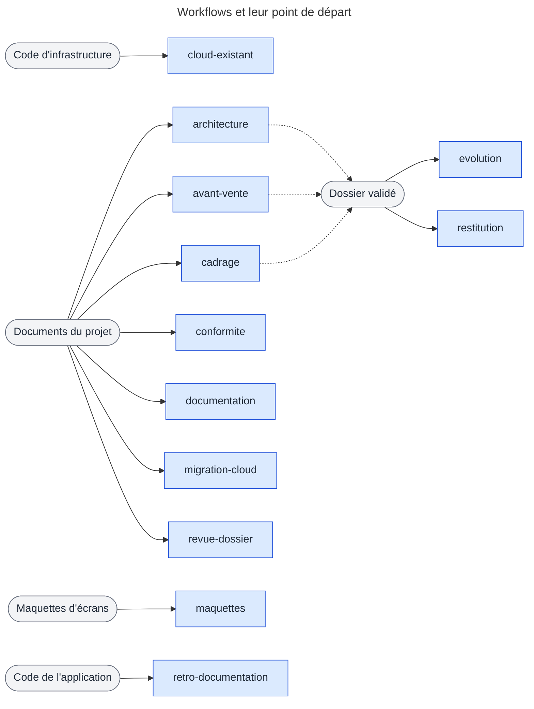

<!-- Fichier généré par scripts/build.py depuis skills/decision-log/workflows/ : ne pas le modifier à la main. -->

# Workflows

Un workflow est une définition JSON (`skills/decision-log/workflows/`) que suit le moteur `architecture-workflow` : des étapes à portes de revue, chacune avec ses skills, ses livrables, ses contrôles par script et, au besoin, un agent spécialisé. Chaque page ci-dessous est tirée de sa définition.

## Carte

En pointillés : les workflows dont le dossier validé (exigences et options) est repris ensuite par les workflows menés dans son sous-dossier (`evolution`, `restitution`).

## Liste

| Workflow | Étapes | Point de départ |
| --- | --- | --- |
| [Des documents du projet aux schémas d'architecture](architecture.md) (`architecture`) | 8 | Documents du projet |
| [Réponse à un appel d'offres, des documents reçus à l'offre](avant-vente.md) (`avant-vente`) | 15 | Documents du projet |
| [Cadrage d'un projet : ateliers, exigences, données, dimensionnement, interfaces et recette](cadrage.md) (`cadrage`) | 9 | Documents du projet |
| [Schémas et menaces d'une infrastructure existante](cloud-existant.md) (`cloud-existant`) | 3 | Code d'infrastructure |
| [Conformité d'une architecture : sécurité, RGPD et hébergement](conformite.md) (`conformite`) | 5 | Documents du projet |
| [Des documents en vrac à une documentation : notes du vault, synthèse, schémas et document](documentation.md) (`documentation`) | 5 | Documents du projet |
| [Évolution d'une solution validée : écarts, impacts, décision et chiffrage du changement](evolution.md) (`evolution`) | 8 | Dossier validé |
| [Maquettes d'écrans vers pages HTML, revue UX et chiffrage frontend](maquettes.md) (`maquettes`) | 4 | Maquettes d'écrans |
| [Migration d'un portefeuille d'applications vers le cloud](migration-cloud.md) (`migration-cloud`) | 6 | Documents du projet |
| [Restitution d'une architecture retenue au comité ou aux décideurs](restitution.md) (`restitution`) | 4 | Dossier validé |
| [Rétro-documentation et modernisation d'une application existante](retro-documentation.md) (`retro-documentation`) | 8 | Code de l'application |
| [Instruction d'un dossier d'architecture reçu](revue-dossier.md) (`revue-dossier`) | 4 | Documents du projet |
