<!-- Fichier généré par scripts/build.py depuis skills/decision-log/workflows/architecture.json : ne pas le modifier à la main. -->

# Des documents du projet aux schémas d'architecture

Workflow `architecture` : 9 étapes, dont 4 facultatives. Point de départ : documents du projet. [Tous les workflows](README.md).

## À quoi il sert

Workflow de l'agent architecture-workflow : documents en Markdown, catalogue d'exigences, 2 ou 3 options comparées et situées dans le SI, choix de l'utilisateur et schémas ; puis, au choix de l'utilisateur, revue d'architecture et chiffrage de l'option retenue, puis le dossier d'architecture technique (DAT) qui rassemble le tout.

## Ce que le moteur demande au départ

- Le vault Obsidian qui sert de mémoire partagée (sans réponse : workflow sans vault)
- Le POS du SI (plan d'occupation des sols : JSON ou CSV d'urbanization-map, ou note avec son tableau), s'il n'est ni dans documents/ ni dans le vault ; sans POS, l'hypothèse se note au journal à l'étape architectures

## Déroulé

```mermaid
---
title: "Des documents du projet aux schémas d'architecture"
---
flowchart LR
  subgraph z_lecture["Lecture du dossier"]
    s_documents["1. Documents en Markdown<br/><small>document-extractor</small>"]
  end
  style z_lecture fill:#f8fafc,stroke:#94a3b8,color:#0f172a
  subgraph z_cadrage["Cadrage"]
    s_exigences["2. Catalogue des exigences<br/><small>architecture-workflow</small>"]
    s_dimensionnement["3. Dimensionnement<br/><small>architecture-workflow</small>"]
    s_domaines["4. Domaines et style d'architecture<br/><small>architecture-workflow</small>"]
  end
  style z_cadrage fill:#f0f9ff,stroke:#94a3b8,color:#0f172a
  subgraph z_solutioning["Solutioning"]
    s_architectures["5. Options d'architecture<br/><small>architecture-workflow</small>"]
    s_schemas["6. Décision et schémas<br/><small>schema-designer</small>"]
    s_revue["7. Revue d'architecture<br/><small>architecture-reviewer</small>"]
  end
  style z_solutioning fill:#f5f3ff,stroke:#94a3b8,color:#0f172a
  subgraph z_chiffrage["Chiffrage"]
    s_chiffrage["8. Chiffrage de l'option retenue<br/><small>solution-estimator</small>"]
  end
  style z_chiffrage fill:#fefce8,stroke:#94a3b8,color:#0f172a
  subgraph z_restitution["Restitution"]
    s_dossier["9. Dossier d'architecture technique<br/><small>architecture-workflow</small>"]
  end
  style z_restitution fill:#f0fdf4,stroke:#94a3b8,color:#0f172a
  s_documents --> s_exigences
  s_exigences --> s_dimensionnement
  s_exigences --> s_domaines
  s_exigences --> s_architectures
  s_domaines --> s_architectures
  s_dimensionnement --> s_architectures
  s_architectures --> s_schemas
  s_schemas --> s_revue
  s_schemas --> s_chiffrage
  s_revue --> s_dossier
  s_chiffrage --> s_dossier
  s_documents ~~~ s_exigences
  s_domaines ~~~ s_architectures
  s_revue ~~~ s_chiffrage
  s_chiffrage ~~~ s_dossier
  classDef moteur fill:#dbeafe,stroke:#1d4ed8,color:#1f2937
  classDef agent fill:#ffedd5,stroke:#c2410c,color:#1f2937
  classDef facultative stroke-dasharray:5 5
  class s_exigences,s_dimensionnement,s_domaines,s_architectures,s_dossier moteur
  class s_documents,s_schemas,s_revue,s_chiffrage agent
  class s_domaines,s_revue,s_chiffrage,s_dossier facultative
```

En bleu, les étapes menées par le moteur `architecture-workflow` ; en orange, celles qu'il confie à un agent spécialisé ; en tirets, les étapes facultatives (l'utilisateur peut les passer). Les étapes sont rangées par zone : lecture du dossier, cadrage, solutioning, chiffrage, restitution. Chaque étape s'arrête pour la revue de l'utilisateur avant la suite.

Étapes prêtes en même temps, menées en parallèle :
- 3. Dimensionnement, 4. Domaines et style d'architecture
- 7. Revue d'architecture, 8. Chiffrage de l'option retenue

## Étapes

| Étape | Zone | Niveau | Menée par | Skills | Livrables | Après |
| --- | --- | --- | --- | --- | --- | --- |
| 1. Documents en Markdown | Lecture du dossier | simple | `document-extractor` | `doc-to-markdown` | `sources/*.md` | début |
| 2. Catalogue des exigences | Cadrage | moyen | `architecture-workflow` | `requirements-catalog` | `donnees/exigences.json`, `exigences.md`, `donnees/exigences.csv` | 1 |
| 3. Dimensionnement | Cadrage | moyen | `architecture-workflow` | `capacity-sizing`, `cloud-cost` | `donnees/dimensionnement.json`, `dimensionnement.md`, `donnees/dimensionnement.result.json` | 2 |
| 4. Domaines et style d'architecture (facultative) | Cadrage | complexe | `architecture-workflow` | `domain-design`, `data-model` | `donnees/domaines.json`, `domaines.md`, `donnees/domaines.styles.json`, `domaines.carte.drawio` | 2 |
| 5. Options d'architecture | Solutioning | complexe | `architecture-workflow` | `architecture-options`, `urbanization-map`, `well-architected-review` | `donnees/options.json`, `options.md` | 2, 4, 3 |
| 6. Décision et schémas | Solutioning | moyen | `schema-designer` | `architecture-options`, `drawio-diagram`, `cloud-architecture`, `well-architected-review`, `urbanization-map`, `diagram-export`, `architecture-deck`, `api-contract` | `donnees/decision.json`, `adr-architecture.md`, `tracabilite.md`, `schemas/architectures.drawio`, `schemas/*.png` | 5 |
| 7. Revue d'architecture (facultative) | Solutioning | complexe | `architecture-reviewer` | `architecture-review`, `threat-model`, `well-architected-review` | `donnees/revue.json`, `revue.md` | 6 |
| 8. Chiffrage de l'option retenue (facultative) | Chiffrage | complexe | `solution-estimator` | `solution-estimate`, `capacity-sizing`, `cloud-cost` | `donnees/chiffrage.json`, `chiffrage.md` | 6 |
| 9. Dossier d'architecture technique (facultative) | Restitution | simple | `architecture-workflow` | `architecture-dossier` | `synthese.md`, `dossier-architecture.md` | 7, 8 |

### 1. Documents en Markdown

- **Entrées** : `documents/*`
- **Livrables** : `sources/*.md`
- **Contrôle** : doc-to-markdown : convert.py <documents> --out sources (--triage TRI.json si l'utilisateur veut le tri, voir classify.py --candidates), puis validate.py sources

Documents nommés par l'utilisateur, sinon ceux de documents/, convertis en une commande ; un document déjà en Markdown est copié tel quel dans sources/. Les pages de vision_pages sont transcrites par la vision ; à partir de 5 documents à transcrire, passer la main à document-extractor. Un document écarté se note au journal avec sa raison.

### 2. Catalogue des exigences

- **Entrées** : `sources/*.md`
- **Livrables** : `donnees/exigences.json`, `exigences.md`, `donnees/exigences.csv`
- **Livrables possibles** : `donnees/exigences.candidats.json`, `donnees/exigences.tri.json`
- **Contrôle** : requirements-catalog : req_build.py donnees/exigences.json --candidates, tri des phrases par un sous-agent de niveau simple (donnees/exigences.tri.json), puis req_build.py donnees/exigences.json : zéro erreur et zéro phrase d'exigence non reprise

req_build.py donnees/exigences.json --draft écrit d'abord une exigence par phrase normative (citation exacte, numérotation des documents, catégorie, priorité et mesure déduites) ; lire chaque sources/*.md une seule fois pour trier ce brouillon (retirer, fusionner, corriger, passer en ignored avec sa raison), ajouter les exigences sans verbe normatif et le glossaire des termes métier et sigles employés. Chaque exigence déduite, priorité non explicite ou phrase écartée se note au journal. Une dimension de volumétrie absente (volumetry_missing du rapport : utilisateurs, pic, débit, données, croissance, conservation) devient une question dans l'exigence la plus proche, présentée à cette revue ; une dimension sans objet se déclare dans volumetry avec sa raison.

### 3. Dimensionnement

- **Entrées** : `donnees/exigences.json`
- **Livrables** : `donnees/dimensionnement.json`, `dimensionnement.md`, `donnees/dimensionnement.result.json`
- **Contrôle** : capacity-sizing : size_build.py donnees/dimensionnement.json : pointe, stockage, sauvegardes et trafic calculés, zéro erreur ; chaque avertissement (pic faible, capacité par défaut) justifié ou noté au journal

Juste après les exigences, avant toute option : utilisateurs, charge et pointe, débits, données et fichiers, croissance, conservation et disponibilité repris des exigences (section Volumétrie d'exigences.md, mesures citées) et des réponses notées au journal ; pas encore de composants. Le rapport donne la pointe, le stockage à l'horizon, les sauvegardes et le trafic, que les options d'architecture doivent tenir. Un volume sans source est une hypothèse notée au journal, ou une question pour l'utilisateur si elle change le résultat.

### 4. Domaines et style d'architecture

- **Entrées** : `donnees/exigences.json`
- **Livrables** : `donnees/domaines.json`, `domaines.md`, `donnees/domaines.styles.json`, `domaines.carte.drawio`
- **Livrables possibles** : `donnees/domaines.carte.json`, `domaines.carte.drawio.png`, `donnees/modele.json`, `modele.md`, `donnees/modele.mmd`, `donnees/modele.sql`
- **Contrôle** : data-model : model_build.py donnees/modele.json (seulement sur un existant : modèle de données actuel, preuve du couplage réel)
- **Contrôle** : domain-design : domain_build.py donnees/domaines.json --export png, avec --vault <vault> --folder <dossier> si le workflow a un vault (zéro erreur ; style recommandé, contextes à extraire et confiance)

Étape facultative, proposée après les exigences quand la solution couvre plusieurs domaines fonctionnels : l'utilisateur dit s'il la veut (start) ou non (skip, avec ses mots). Sous-domaines, contextes bornés, langage et carte des contextes tirés des exigences, du glossaire et des processus métier, pas des données : sur un projet neuf, le modèle de données de chaque contexte vient après (data-model, champ context) ; sur un existant, le modèle actuel (model) mesure le couplage réel ; un facteur de la grille inconnu (équipes, maturité DevOps, cohérence exigée) se demande une seule fois, sans réponse il reste absent et la confiance baisse. À la revue, présenter le style recommandé (monolithe modulaire, mixte ou microservices), les contextes à extraire et la carte ; le style retenu par l'utilisateur va dans decision de donnees/domaines.json et se note au journal.

### 5. Options d'architecture

- **Entrées** : `donnees/exigences.json`, `documents/pos*`, `donnees/domaines.json`, `donnees/domaines.styles.json`, `donnees/dimensionnement.result.json`
- **Livrables** : `donnees/options.json`, `options.md`
- **Livrables possibles** : `tracabilite.md`, `donnees/tracabilite.csv`, `schemas/option-*.cloud.json`, `schemas/option-*.wa.md`, `schemas/pos-option-*.json`
- **Contrôle** : architecture-options : options_build.py donnees/options.json --draft d'abord (critères, qualifications exigées, hébergeurs qualifiés), puis options_build.py donnees/options.json (placement dans le POS et revue Well-Architected des piliers de chaque option cloud inclus)

2 ou 3 options notées et justifiées, refs des composants ; provider et type pour une option cloud ; avec le POS du SI (pos, ou vault:<chemin>), le placement de chaque option et la note du critère urbanisation. Une redondance signalée se corrige (remplacer l'existant) ou se justifie (coexists), et ce choix se note au journal. Un constat Well-Architected d'une option cloud nourrit ses notes : composant ajouté, ou écart accepté avec sa raison dans wa_accept ; une gravité haute ne reste jamais sans réponse. Après l'étape domaines, une option reprend les components et flows du style retenu ou recommandé (donnees/domaines.styles.json), une autre l'alternative la plus proche ; leurs composants gardent contexts. À la revue, présenter l'option recommandée et le choix à faire. Les options tiennent le dimensionnement (donnees/dimensionnement.result.json : pointe, stockage, disponibilité) : les notes de performance et de coût le citent, une option qui ne le tient pas le dit.

### 6. Décision et schémas

- **Entrées** : `donnees/options.json`, `donnees/exigences.json`
- **Livrables** : `donnees/decision.json`, `adr-architecture.md`, `tracabilite.md`, `schemas/architectures.drawio`, `schemas/*.png`
- **Livrables possibles** : `donnees/tracabilite.csv`, `schemas/option-*.drawio`, `schemas/option-*.conventions.md`, `schemas/pos-option-*.drawio`, `presentation.md`, `api/*`
- **Contrôle** : architecture-options : options_build.py donnees/options.json --decision donnees/decision.json
- **Contrôle** : drawio-diagram : drawio_build.py schemas/architectures.json --export png
- **Contrôle** : cloud-architecture : cloud_build.py schemas/option-<id>.cloud.json --export png (option cloud retenue), puis well-architected-review : wa_check.py --scope conventions --out schemas/option-<id>.conventions.md sur ce fichier (option-<id>.wa.md, validé à l'étape architectures, ne change pas)
- **Contrôle** : urbanization-map : pos_build.py schemas/pos-option-<id>.json (POS cible de chaque option, si POS)
- **Contrôle** : diagram-export : export.py en PNG des schémas construits sans --export (POS), puis relire chaque image une fois
- **Contrôle** : si l'utilisateur veut les contrats d'interface de l'option retenue : api-contract : api_build.py api/api.json (requirements ../donnees/exigences.json, source ../donnees/options.json et l'option)
- **Contrôle** : si l'utilisateur veut une présentation : architecture-deck : deck_build.py . (le .pptx passe ensuite par document-publisher)

donnees/decision.json reprend le choix fait par l'utilisateur à la revue précédente : option, by, ses mots dans why, date, refs. options_build.py --decision n'écrit que l'ADR et la traçabilité de l'option retenue : donnees/options.json et options.md validés ne changent pas. Les constructions sont mécaniques et restent à l'agent du workflow ; un schéma C4 ou cloud détaillé demandé par l'utilisateur passe à schema-designer, un modèle de menaces à architecture-reviewer. La présentation, facultative, se construit après les PNG, à partir des seuls fichiers validés, et ne se réécrit pas.

### 7. Revue d'architecture

- **Entrées** : `donnees/options.json`, `donnees/exigences.json`, `donnees/decision.json`, `adr-architecture.md`, `schemas/option-*.cloud.json`, `donnees/domaines.json`
- **Livrables** : `donnees/revue.json`, `revue.md`
- **Livrables possibles** : `schemas/option-*.threats.md`
- **Contrôle** : architecture-review : arch_review.py donnees/revue.json --vault <vault> --folder <dossier> si le workflow a un vault (avis calculé ; constat de gravité haute traité ou accepté avec la raison de l'utilisateur ; avec donnees/domaines.json, donnees/revue.json porte domains et les règles DOM- contrôlent le découpage)
- **Contrôle** : si l'option retenue est cloud et que l'utilisateur veut les menaces : threat-model : stride.py schemas/option-<id>.cloud.json, avec --vault <vault> --folder <dossier> --option <id> si le workflow a un vault

Étape facultative, proposée après la décision : l'utilisateur dit s'il la veut (start) ou non (skip, avec ses mots). donnees/revue.json reprend l'option retenue (source vers donnees/options.json et son id), les exigences et l'ADR ; les scénarios de qualité, risques et compromis demandent du jugement et passent à architecture-reviewer, qui rend donnees/revue.json. Un écart n'est accepté qu'avec la raison donnée par l'utilisateur, notée au journal. La revue Well-Architected de l'option est celle de l'étape architectures (schemas/option-<id>.wa.md, validé) : la lire telle quelle, sans relancer wa_check.py sur la description (il réécrirait ce livrable validé et bloquerait les étapes suivantes).

### 8. Chiffrage de l'option retenue

- **Entrées** : `donnees/exigences.json`, `donnees/options.json`, `donnees/decision.json`, `donnees/dimensionnement.json`
- **Livrables** : `donnees/chiffrage.json`, `chiffrage.md`
- **Livrables possibles** : `donnees/chiffrage.csv`, `donnees/couts.json`, `couts.md`, `donnees/couts.csv`, `donnees/dimensionnement-option.json`, `dimensionnement-option.md`, `donnees/dimensionnement-option.result.json`, `donnees/dimensionnement-option.couts.json`
- **Contrôle** : capacity-sizing : size_build.py donnees/dimensionnement-option.json (--provider <fournisseur> --option <option> pour une option cloud), puis cloud-cost : cost_build.py donnees/dimensionnement-option.couts.json --infra <option> (ou donnees/couts.json s'il complète le dimensionnement) pour une option cloud (coût de run calculé sur la grille locale ; ses lignes vont dans infra de donnees/chiffrage.json)
- **Contrôle** : solution-estimate : estimate_build.py donnees/chiffrage.json, avec --vault <vault> --folder <dossier> si le workflow a un vault (zéro erreur ; hébergeur et qualifications exigées vérifiés)

Étape facultative : l'utilisateur dit s'il la veut (start) ou non (skip, avec ses mots). Demander une seule fois les taux journaliers, l'horizon et le budget ; sans réponse, chaque valeur prise est une hypothèse notée au journal. Le découpage en lots et les estimations à trois points passent à solution-estimator ; totaux, fourchette et coût total sont calculés par le script. Les volumes viennent de l'étape dimensionnement : avant de passer la main, donnees/dimensionnement-option.json reprend donnees/dimensionnement.json avec les components de l'option retenue, puis size_build.py donnees/dimensionnement-option.json (--provider et --option pour une option cloud) dimensionne les instances et écrit donnees/dimensionnement-option.couts.json ; cost_build.py sur ce fichier --infra <option> donne les lignes d'infrastructure. Aucune question de volumétrie n'est reposée, une valeur manquante est une hypothèse notée au journal.

### 9. Dossier d'architecture technique

- **Entrées** : `exigences.md`, `options.md`, `adr-architecture.md`, `schemas/*.png`, `revue.md`, `chiffrage.md`, `journal.md`
- **Livrables** : `synthese.md`, `dossier-architecture.md`
- **Livrables possibles** : `plan-actions.md`, `donnees/plan-actions.csv`
- **Contrôle** : architecture-dossier : actions.py . si une revue, des menaces ou une AIPD ont été faites (plan d'actions repris par le dossier)
- **Contrôle** : architecture-dossier : dossier_build.py . --strict (sections obligatoires présentes, liens et images vérifiés)
- **Contrôle** : si l'utilisateur veut un Word ou un PDF : passer dossier-architecture.md à document-publisher

Étape facultative, proposée en dernier : l'utilisateur dit s'il la veut (start) ou non (skip, avec ses mots). Écrire synthese.md (une page : objet, option retenue et pourquoi, avis de la revue, coût, points ouverts) à partir des rapports des étapes précédentes, sans relire les livrables ; le reste est assemblé par le script.

## Mémoire partagée

Fichiers que le moteur reporte dans le vault Obsidian, quand le workflow en a un :

- requirements : `donnees/exigences.json`
- options : `donnees/options.json`
- decision : `donnees/decision.json`
- adr : `adr-architecture.md`
