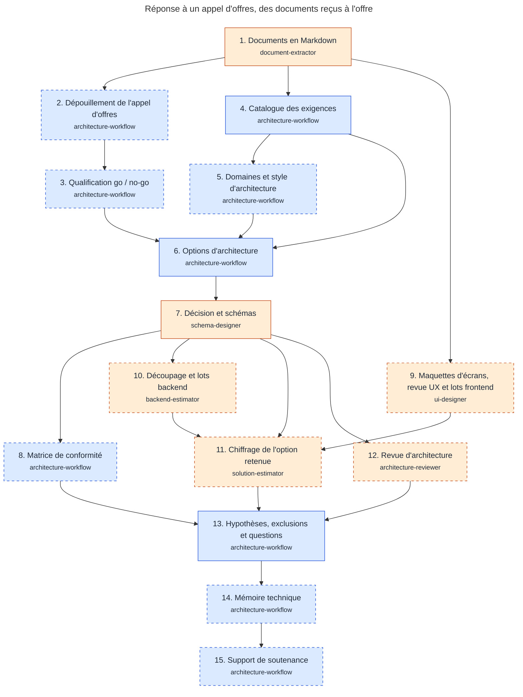

<!-- Fichier généré par scripts/build.py depuis skills/decision-log/workflows/avant-vente.json : ne pas le modifier à la main. -->

# Réponse à un appel d'offres, des documents reçus à l'offre

Workflow `avant-vente` : 15 étapes, dont 10 facultatives. Point de départ : documents du projet. [Tous les workflows](README.md).

## À quoi il sert

Workflow d'avant-vente de l'agent architecture-workflow : documents du dossier de consultation en Markdown, dépouillement (dates limites, critères pondérés, pièces, clauses à risque) et qualification go / no-go menés en parallèle du catalogue d'exigences, découpage en domaines facultatif, 2 ou 3 options de solution et la décision, puis matrice de conformité, chiffrage de la solution et revue en parallèle, registre des hypothèses et questions au client, mémoire technique dans l'ordre des critères et support de soutenance ; une porte de revue par étape.

## Ce que le moteur demande au départ

- Le vault Obsidian qui sert de mémoire partagée (sans réponse : workflow sans vault)
- Le POS du SI (plan d'occupation des sols : JSON ou CSV d'urbanization-map, ou note avec son tableau), s'il n'est ni dans documents/ ni dans le vault ; sans POS, l'hypothèse se note au journal à l'étape architectures

## Déroulé

En bleu, les étapes menées par le moteur `architecture-workflow` ; en orange, celles qu'il confie à un agent spécialisé ; en tirets, les étapes facultatives (l'utilisateur peut les passer). Chaque étape s'arrête pour la revue de l'utilisateur avant la suite.

Étapes prêtes en même temps, menées en parallèle :
- 2. Dépouillement de l'appel d'offres, 4. Catalogue des exigences, 9. Maquettes d'écrans, revue UX et lots frontend
- 3. Qualification go / no-go, 5. Domaines et style d'architecture
- 8. Matrice de conformité, 10. Découpage et lots backend, 12. Revue d'architecture

## Étapes

| Étape | Niveau | Menée par | Skills | Livrables | Après |
| --- | --- | --- | --- | --- | --- |
| 1. Documents en Markdown | simple | `document-extractor` | `doc-to-markdown` | `sources/*.md` | début |
| 2. Dépouillement de l'appel d'offres (facultative) | moyen | `architecture-workflow` | `tender-response` | `ao.json`, `ao.md` | 1 |
| 3. Qualification go / no-go (facultative) | complexe | `architecture-workflow` | `tender-response`, `decision-log` | `qualification.json`, `qualification.md` | 2 |
| 4. Catalogue des exigences | moyen | `architecture-workflow` | `requirements-catalog` | `exigences.json`, `exigences.md`, `exigences.csv` | 1 |
| 5. Domaines et style d'architecture (facultative) | complexe | `architecture-workflow` | `domain-design`, `data-model` | `domaines.json`, `domaines.md`, `domaines.styles.json`, `domaines.carte.drawio` | 4 |
| 6. Options d'architecture | complexe | `architecture-workflow` | `architecture-options`, `urbanization-map`, `well-architected-review` | `options.json`, `options.md` | 4, 3, 5 |
| 7. Décision et schémas | moyen | `schema-designer` | `architecture-options`, `drawio-diagram`, `cloud-architecture`, `well-architected-review`, `urbanization-map`, `diagram-export`, `api-contract` | `decision.json`, `adr-architecture.md`, `tracabilite.md`, `schemas/architectures.drawio`, `schemas/*.png` | 6 |
| 8. Matrice de conformité (facultative) | moyen | `architecture-workflow` | `tender-response` | `conformite.json`, `conformite.md`, `conformite.xlsx` | 7 |
| 9. Maquettes d'écrans, revue UX et lots frontend (facultative) | moyen | `ui-designer` | `mockup-to-html`, `design-system` | `design-system.json`, `pages/*.json`, `revue-ux.json`, `decoupage.md`, `decoupage.lots.json` | 1 |
| 10. Découpage et lots backend (facultative) | moyen | `backend-estimator` | `api-contract` | `decoupage-back.lots.json`, `decoupage-back.md` | 7 |
| 11. Chiffrage de l'option retenue (facultative) | moyen | `solution-estimator` | `solution-estimate`, `cloud-cost` | `chiffrage.json`, `chiffrage.md` | 7, 9, 10 |
| 12. Revue d'architecture (facultative) | moyen | `architecture-reviewer` | `architecture-review`, `threat-model`, `well-architected-review` | `revue.json`, `revue.md` | 7 |
| 13. Hypothèses, exclusions et questions | moyen | `architecture-workflow` | `tender-response`, `decision-log` | `registre.json`, `registre.md`, `questions-client.md` | 8, 11, 12 |
| 14. Mémoire technique (facultative) | moyen | `architecture-workflow` | `architecture-dossier`, `tender-response` | `memoire/comprehension.md`, `memoire/solution.md`, `memoire-technique.md` | 13 |
| 15. Support de soutenance (facultative) | simple | `architecture-workflow` | `architecture-deck` | `presentation.md` | 14 |

### 1. Documents en Markdown

- **Entrées** : `documents/*`
- **Livrables** : `sources/*.md`
- **Contrôle** : doc-to-markdown : convert.py <documents> --out sources (--classify si l'utilisateur veut le tri), puis validate.py sources

Documents nommés par l'utilisateur, sinon ceux de documents/, convertis en une commande ; un document déjà en Markdown est copié tel quel dans sources/. Les pages de vision_pages sont transcrites par la vision ; à partir de 5 documents à transcrire, passer la main à document-extractor. Un document écarté se note au journal avec sa raison.

### 2. Dépouillement de l'appel d'offres

- **Entrées** : `sources/*.md`
- **Livrables** : `ao.json`, `ao.md`
- **Contrôle** : tender-response : tender_build.py ao.json --draft, relu et noté, puis tender_build.py ao.json : zéro erreur et zéro élément du dossier non repris (uncovered)

Étape facultative, à faire dès qu'un règlement de consultation est fourni (sinon skip, avec les mots de l'utilisateur). tender_build.py --draft écrit dates, critères pondérés, pièces, format et clauses à risque avec leurs citations ; corriger le thème de chaque critère (il range le mémoire), noter chaque clause (pourquoi, que faire) et ajuster son niveau. À la revue, donner d'abord les jours restants avant la date limite des questions et la remise (deadlines du rapport). Une clause acceptée en l'état se note au journal.

### 3. Qualification go / no-go

- **Entrées** : `ao.json`, `ao.md`
- **Livrables** : `qualification.json`, `qualification.md`
- **Contrôle** : tender-response : qualify.py qualification.json --draft, notes et raisons, puis qualify.py qualification.json --log qualification une fois la décision de l'utilisateur écrite (note et recommandation calculées, décision tracée au journal)

Étape facultative, juste après le dépouillement : décider s'il faut répondre avant d'engager le travail. Le brouillon reprend la grille et les indices du dépouillement (jours avant la remise, clauses à risque, pièces, critères) ; noter chaque critère de 0 à 5 avec sa raison. À la revue, présenter la note, la recommandation et les critères faibles ; la décision est celle de l'utilisateur (decision : choice, by, why avec ses mots, conditions). Un no-go arrête le workflow : sauter les étapes suivantes avec ses mots.

### 4. Catalogue des exigences

- **Entrées** : `sources/*.md`
- **Livrables** : `exigences.json`, `exigences.md`, `exigences.csv`
- **Livrables possibles** : `exigences.candidats.json`, `exigences.tri.json`
- **Contrôle** : requirements-catalog : req_build.py exigences.json --candidates, tri des phrases par un sous-agent de niveau simple (exigences.tri.json), puis req_build.py exigences.json : zéro erreur et zéro phrase d'exigence non reprise

req_build.py exigences.json --draft écrit d'abord une exigence par phrase normative (citation exacte, numérotation des documents, catégorie, priorité et mesure déduites) ; lire chaque sources/*.md une seule fois pour trier ce brouillon (retirer, fusionner, corriger, passer en ignored avec sa raison), ajouter les exigences sans verbe normatif et le glossaire des termes métier et sigles employés. Chaque exigence déduite, priorité non explicite ou phrase écartée se note au journal.

### 5. Domaines et style d'architecture

- **Entrées** : `exigences.json`
- **Livrables** : `domaines.json`, `domaines.md`, `domaines.styles.json`, `domaines.carte.drawio`
- **Livrables possibles** : `domaines.carte.json`, `domaines.carte.drawio.png`, `modele.json`, `modele.md`, `modele.mmd`, `modele.sql`
- **Contrôle** : data-model : model_build.py modele.json (seulement sur un existant : modèle de données actuel, preuve du couplage réel)
- **Contrôle** : domain-design : domain_build.py domaines.json --export png, avec --vault <vault> --folder <dossier> si le workflow a un vault (zéro erreur ; style recommandé, contextes à extraire et confiance)

Étape facultative, proposée après les exigences quand la solution couvre plusieurs domaines fonctionnels ou que le dossier de consultation demande un style (microservices, monolithe modulaire) : l'utilisateur dit s'il la veut (start) ou non (skip, avec ses mots). Sous-domaines, contextes bornés, langage et carte des contextes tirés des exigences, du glossaire et des processus métier, pas des données : sur un projet neuf, le modèle de données de chaque contexte vient après (data-model, champ context) ; sur un existant, le modèle actuel (model) mesure le couplage réel ; un facteur de la grille inconnu (équipes, maturité DevOps, cohérence exigée) se demande une seule fois, sans réponse il reste absent et la confiance baisse. À la revue, présenter le style recommandé (monolithe modulaire, mixte ou microservices), les contextes à extraire et la carte ; le style retenu par l'utilisateur va dans decision de domaines.json et se note au journal.

### 6. Options d'architecture

- **Entrées** : `exigences.json`, `documents/pos*`, `domaines.json`, `domaines.styles.json`
- **Livrables** : `options.json`, `options.md`
- **Livrables possibles** : `tracabilite.md`, `tracabilite.csv`, `schemas/option-*.cloud.json`, `schemas/option-*.wa.md`, `schemas/pos-option-*.json`
- **Contrôle** : architecture-options : options_build.py options.json --draft d'abord (critères, qualifications exigées, hébergeurs qualifiés), puis options_build.py options.json (placement dans le POS et revue Well-Architected des piliers de chaque option cloud inclus)

2 ou 3 options notées et justifiées, refs des composants ; provider et type pour une option cloud ; avec le POS du SI (pos, ou vault:<chemin>), le placement de chaque option et la note du critère urbanisation. Une redondance signalée se corrige (remplacer l'existant) ou se justifie (coexists), et ce choix se note au journal. Un constat Well-Architected d'une option cloud nourrit ses notes : composant ajouté, ou écart accepté avec sa raison dans wa_accept ; une gravité haute ne reste jamais sans réponse. Après l'étape domaines, une option reprend les components et flows du style retenu ou recommandé (domaines.styles.json), une autre l'alternative la plus proche ; leurs composants gardent contexts. À la revue, présenter l'option recommandée et le choix à faire.

### 7. Décision et schémas

- **Entrées** : `options.json`, `exigences.json`
- **Livrables** : `decision.json`, `adr-architecture.md`, `tracabilite.md`, `schemas/architectures.drawio`, `schemas/*.png`
- **Livrables possibles** : `tracabilite.csv`, `schemas/option-*.drawio`, `schemas/option-*.conventions.md`, `schemas/pos-option-*.drawio`, `api/*`
- **Contrôle** : architecture-options : options_build.py options.json --decision decision.json
- **Contrôle** : drawio-diagram : drawio_build.py schemas/architectures.json --export png
- **Contrôle** : cloud-architecture : cloud_build.py schemas/option-<id>.cloud.json --export png (option cloud retenue), puis well-architected-review : wa_check.py --scope conventions --out schemas/option-<id>.conventions.md sur ce fichier (option-<id>.wa.md, validé à l'étape architectures, ne change pas)
- **Contrôle** : urbanization-map : pos_build.py schemas/pos-option-<id>.json (POS cible de chaque option, si POS)
- **Contrôle** : diagram-export : export.py en PNG des schémas construits sans --export (POS), puis relire chaque image une fois
- **Contrôle** : si l'utilisateur veut les contrats d'interface de l'option retenue : api-contract : api_build.py api/api.json (requirements ../exigences.json, source ../options.json et l'option)

decision.json reprend le choix fait par l'utilisateur à la revue précédente : option, by, ses mots dans why, date, refs. options_build.py --decision n'écrit que l'ADR et la traçabilité de l'option retenue : options.json et options.md validés ne changent pas. Les constructions sont mécaniques et restent à l'agent du workflow ; un schéma C4 ou cloud détaillé demandé par l'utilisateur passe à schema-designer, un modèle de menaces à architecture-reviewer.

### 8. Matrice de conformité

- **Entrées** : `exigences.json`, `options.json`, `decision.json`
- **Livrables** : `conformite.json`, `conformite.md`, `conformite.xlsx`
- **Livrables possibles** : `conformite.csv`
- **Contrôle** : tender-response : compliance_build.py conformite.json --draft, puis compliance_build.py conformite.json : une réponse par exigence retenue, chaque réponse partielle ou non conforme justifiée

Étape facultative : à faire quand l'acheteur demande une matrice de conformité ou un cadre de réponse. Le brouillon tire chaque réponse des écarts de l'option retenue ; n'écrire que la justification des réponses partielles et non conformes, pour l'acheteur. Une réponse qui contredit l'option se tranche avec l'utilisateur et se note au journal.

### 9. Maquettes d'écrans, revue UX et lots frontend

- **Entrées** : `maquettes/*`, `sources/attachments/*`
- **Livrables** : `design-system.json`, `pages/*.json`, `revue-ux.json`, `decoupage.md`, `decoupage.lots.json`
- **Livrables possibles** : `analyses/*.analysis.json`, `pages/*.html`, `pages/*.ux.md`, `decoupage.json`, `decoupage.csv`
- **Contrôle** : design-system : ds_extract.py <maquettes> --draft design-system.json (ou ds_import.py des tokens du client), puis ds_build.py design-system.json
- **Contrôle** : mockup-to-html : ui_analyze.py <maquettes> --tokens design-system.json --draft --out-dir analyses, page_build.py pages/<écran>.json pour chaque écran, ux_review.py revue-ux.json, puis ui_breakdown.py pages/*.json --out decoupage --ux revue-ux.json

Étape facultative, proposée quand le dossier de consultation contient des maquettes d'écrans (images de documents/ ou extraites dans sources/attachments/) : l'utilisateur dit s'il la veut. Mêmes règles que le workflow maquettes : descriptions dans pages/, jamais de HTML à la main ; constats UX retenus avec l'utilisateur ; decoupage.lots.json repris par le chiffrage (--lots).

### 10. Découpage et lots backend

- **Entrées** : `exigences.json`, `options.json`, `decision.json`
- **Livrables** : `decoupage-back.lots.json`, `decoupage-back.md`
- **Livrables possibles** : `api/api.json`, `api/*`, `decoupage-back.json`, `decoupage-back.csv`
- **Contrôle** : api-contract : api_build.py api/api.json (s'il manque : --draft --requirements exigences.json --options options.json --option <retenue>, puis complété), puis api_breakdown.py api/api.json --out decoupage-back (--abaques si fournis) ; ajustements dans decoupage-back.lots.json avec leur raison (note)

Étape facultative, proposée dans la même question que le chiffrage : faite si l'utilisateur veut le chiffrage, sautée avec lui. Elle passe à backend-estimator (niveau moyen), lancé en parallèle des autres étapes prêtes, avec le dossier, l'option retenue et les chemins de api_build.py et api_breakdown.py ; api/api.json de l'étape schémas est repris s'il existe, jamais réécrit. Le chiffrage reprend ses lots (--lots decoupage-back.lots.json) sans refaire le découpage.

### 11. Chiffrage de l'option retenue

- **Entrées** : `exigences.json`, `options.json`, `decision.json`
- **Livrables** : `chiffrage.json`, `chiffrage.md`
- **Livrables possibles** : `chiffrage.csv`, `couts.json`, `couts.md`, `couts.csv`
- **Contrôle** : cloud-cost : cost_build.py couts.json --infra <option> pour une option cloud (coût de run calculé sur la grille locale ; ses lignes vont dans infra de chiffrage.json)
- **Contrôle** : solution-estimate : estimate_build.py chiffrage.json, avec --vault <vault> --folder <dossier> si le workflow a un vault (zéro erreur ; hébergeur et qualifications exigées vérifiés)

Étape facultative : l'utilisateur dit s'il la veut (start) ou non (skip, avec ses mots). Demander une seule fois les taux journaliers, l'horizon et le budget ; sans réponse, chaque valeur prise est une hypothèse notée au journal. Le découpage en lots et les estimations à trois points passent à solution-estimator ; totaux, fourchette et coût total sont calculés par le script. En avant-vente, solution-estimator est lancé au niveau de l'étape (moyen) : le brouillon et les lots des experts font le découpage, il complète et arbitre ; il ne remonte au niveau complexe que s'il bute. Le brouillon reprend les lots des étapes backend et maquettes faites : estimate_build.py chiffrage.json --draft --lots decoupage-back.lots.json [--lots decoupage.lots.json] ; le backend n'est redécoupé que si l'étape backend est sautée.

### 12. Revue d'architecture

- **Entrées** : `options.json`, `exigences.json`, `decision.json`, `adr-architecture.md`, `schemas/option-*.cloud.json`
- **Livrables** : `revue.json`, `revue.md`
- **Livrables possibles** : `schemas/option-*.threats.md`
- **Contrôle** : architecture-review : arch_review.py revue.json --vault <vault> --folder <dossier> si le workflow a un vault (avis calculé ; constat de gravité haute traité ou accepté avec la raison de l'utilisateur)
- **Contrôle** : si l'option retenue est cloud et que l'utilisateur veut les menaces : threat-model : stride.py schemas/option-<id>.cloud.json, avec --vault <vault> --folder <dossier> --option <id> si le workflow a un vault

Étape facultative, proposée après la décision : l'utilisateur dit s'il la veut (start) ou non (skip, avec ses mots). revue.json reprend l'option retenue (source vers options.json et son id), les exigences et l'ADR ; les scénarios de qualité, risques et compromis demandent du jugement et passent à architecture-reviewer, lancé au niveau de l'étape (moyen) sur le brouillon arch_review.py revue.json --draft (scénarios tirés des exigences de qualité), qui rend revue.json ; il ne remonte au niveau complexe que s'il bute. Un écart n'est accepté qu'avec la raison donnée par l'utilisateur, notée au journal. La revue Well-Architected de l'option est celle de l'étape architectures (schemas/option-<id>.wa.md, validé) : la lire telle quelle, sans relancer wa_check.py sur la description (il réécrirait ce livrable validé et bloquerait les étapes suivantes).

### 13. Hypothèses, exclusions et questions

- **Entrées** : `exigences.json`, `chiffrage.json`, `ao.json`, `workflow.json`
- **Livrables** : `registre.json`, `registre.md`, `questions-client.md`
- **Livrables possibles** : `registre.csv`
- **Contrôle** : tender-response : assumptions.py registre.json --draft, puis assumptions.py registre.json : zéro erreur, chaque référence connue

Le brouillon reprend les questions des exigences, les hypothèses et exclusions du chiffrage et du journal. Reformuler chaque question pour le client, ajouter les prérequis et les questions sur les clauses à risque du dépouillement. Les questions partent avant la date limite des questions (rapport : deadline) ; après elle, une question sans réponse devient une hypothèse de l'offre.

### 14. Mémoire technique

- **Entrées** : `ao.json`, `options.md`, `adr-architecture.md`, `schemas/*.png`, `conformite.md`, `registre.md`, `chiffrage.md`, `revue.md`
- **Livrables** : `memoire/comprehension.md`, `memoire/solution.md`, `memoire-technique.md`
- **Livrables possibles** : `memoire/*.md`
- **Contrôle** : architecture-dossier : dossier_build.py . --template memoire --tender ao.json --out memoire-technique.md --strict (chaque critère noté a sa section, budget de pages du règlement tenu)
- **Contrôle** : si l'utilisateur veut un Word ou un PDF : passer memoire-technique.md à document-publisher

Étape facultative, quand l'appel d'offres demande un mémoire technique. Écrire dans memoire/ une section par thème des critères (comprehension, solution, securite, methodologie, maintenance, equipe, environnement), pour l'acheteur, en reprenant les rapports des étapes validées sans relire les livrables ; le script range les sections dans l'ordre des critères, rappelle chaque critère et son poids, et contrôle la couverture et le budget de pages.

### 15. Support de soutenance

- **Entrées** : `options.md`, `adr-architecture.md`, `schemas/*.png`
- **Livrables** : `presentation.md`
- **Contrôle** : architecture-deck : deck_build.py . (le .pptx passe ensuite par document-publisher)

Étape facultative, quand le règlement prévoit une soutenance (date de nature soutenance dans ao.json). Le support se construit par le script à partir des seuls fichiers validés et ne se réécrit pas.

## Mémoire partagée

Fichiers que le moteur reporte dans le vault Obsidian, quand le workflow en a un :

- requirements : `exigences.json`
- options : `options.json`
- decision : `decision.json`
- adr : `adr-architecture.md`
