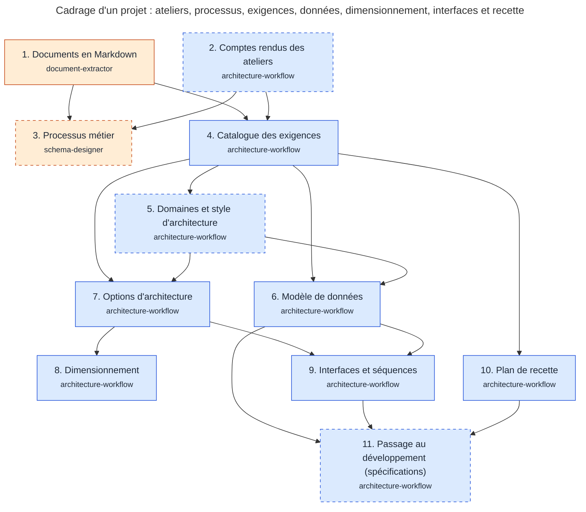

<!-- Fichier généré par scripts/build.py depuis skills/decision-log/workflows/cadrage.json : ne pas le modifier à la main. -->

# Cadrage d'un projet : ateliers, processus, exigences, données, dimensionnement, interfaces et recette

Workflow `cadrage` : 11 étapes, dont 4 facultatives. Point de départ : documents du projet. [Tous les workflows](README.md).

## À quoi il sert

Workflow de cadrage de l'agent architecture-workflow : comptes rendus des ateliers et documents, au choix processus métier en couloirs, catalogue d'exigences, découpage en domaines facultatif, puis modèle de données par contexte et options d'architecture en parallèle, dimensionnement, contrats d'interface avec leurs séquences et plan de recette, puis au choix export vers BMAD Method pour le développement ; une porte de revue par étape.

## Ce que le moteur demande au départ

- Le vault Obsidian qui sert de mémoire partagée (sans réponse : workflow sans vault)

## Déroulé

En bleu, les étapes menées par le moteur `architecture-workflow` ; en orange, celles qu'il confie à un agent spécialisé ; en tirets, les étapes facultatives (l'utilisateur peut les passer). Chaque étape s'arrête pour la revue de l'utilisateur avant la suite.

Étapes prêtes en même temps, menées en parallèle :
- 1. Documents en Markdown, 2. Comptes rendus des ateliers
- 3. Processus métier, 4. Catalogue des exigences
- 5. Domaines et style d'architecture, 10. Plan de recette
- 6. Modèle de données, 7. Options d'architecture
- 8. Dimensionnement, 9. Interfaces et séquences

## Étapes

| Étape | Niveau | Menée par | Skills | Livrables | Après |
| --- | --- | --- | --- | --- | --- |
| 1. Documents en Markdown | simple | `document-extractor` | `doc-to-markdown` | `sources/*.md` | début |
| 2. Comptes rendus des ateliers (facultative) | moyen | `architecture-workflow` | `meeting-notes` | `comptes-rendus/*.json`, `comptes-rendus/*.md` | début |
| 3. Processus métier (facultative) | moyen | `schema-designer` | `process-diagram`, `diagram-export` | `processus/*.json`, `processus/*.drawio`, `processus/*.processus.md` | 1, 2 |
| 4. Catalogue des exigences | moyen | `architecture-workflow` | `requirements-catalog` | `donnees/exigences.json`, `exigences.md`, `donnees/exigences.csv` | 1, 2 |
| 5. Domaines et style d'architecture (facultative) | complexe | `architecture-workflow` | `domain-design` | `donnees/domaines.json`, `domaines.md`, `donnees/domaines.styles.json`, `domaines.carte.drawio` | 4 |
| 6. Modèle de données | moyen | `architecture-workflow` | `data-model` | `donnees/modele.json`, `donnees/modele.mmd`, `modele.md`, `donnees/modele.sql` | 4, 5 |
| 7. Options d'architecture | complexe | `architecture-workflow` | `architecture-options`, `urbanization-map`, `well-architected-review` | `donnees/options.json`, `options.md` | 4, 5 |
| 8. Dimensionnement | moyen | `architecture-workflow` | `capacity-sizing`, `cloud-cost` | `donnees/dimensionnement.json`, `dimensionnement.md`, `donnees/dimensionnement.result.json` | 7 |
| 9. Interfaces et séquences | moyen | `architecture-workflow` | `api-contract`, `mermaid-diagram` | `donnees/api.json`, `donnees/api.openapi.yaml`, `api.api.md`, `api.sequences.md` | 7, 6 |
| 10. Plan de recette | moyen | `architecture-workflow` | `test-plan` | `donnees/recette.json`, `recette.md`, `donnees/recette.csv` | 4 |
| 11. Passage au développement (spécifications) (facultative) | simple | `architecture-workflow` | `spec-pack` | `specs/README.md`, `specs/fonctionnel.md`, `specs/tests.md`, `specs/livraison.md` | 6, 9, 10 |

### 1. Documents en Markdown

- **Entrées** : `documents/*`
- **Livrables** : `sources/*.md`
- **Contrôle** : doc-to-markdown : convert.py <documents> --out sources (--triage TRI.json si l'utilisateur veut le tri, voir classify.py --candidates), puis validate.py sources

Documents nommés par l'utilisateur, sinon ceux de documents/, convertis en une commande ; un document déjà en Markdown est copié tel quel dans sources/. Les pages de vision_pages sont transcrites par la vision ; à partir de 5 documents à transcrire, passer la main à document-extractor. Un document écarté se note au journal avec sa raison.

### 2. Comptes rendus des ateliers

- **Entrées** : `reunions/*`
- **Livrables** : `comptes-rendus/*.json`, `comptes-rendus/*.md`
- **Livrables possibles** : `comptes-rendus/*.actions.csv`
- **Contrôle** : meeting-notes : notes_build.py comptes-rendus/<réunion>.json pour chaque atelier (citations retrouvées dans la transcription, actions en CSV relu)

Étape facultative, à faire dès qu'il y a des notes ou transcriptions d'ateliers dans reunions/ (sinon skip, avec les mots de l'utilisateur) ; elle ne dépend pas des documents et se mène en parallèle. Un compte rendu par réunion : décisions, actions avec porteur et échéance, questions ouvertes, exigences exprimées citées mot pour mot. Une action sans porteur ou une décision déduite se note au journal.

### 3. Processus métier

- **Entrées** : `sources/*.md`, `comptes-rendus/*.md`
- **Livrables** : `processus/*.json`, `processus/*.drawio`, `processus/*.processus.md`
- **Livrables possibles** : `processus/*.drawio.png`
- **Contrôle** : process-diagram : process_build.py processus/<processus>.json --export png pour chaque processus (zéro erreur : ni impasse ni décision sans libellé ; fiche du déroulé écrite), puis relire l'image une fois

Étape facultative, à faire quand les documents ou les ateliers décrivent un parcours métier à plusieurs acteurs (sinon skip, avec les mots de l'utilisateur) ; elle se mène en parallèle des exigences. Un processus par parcours, trois au plus : acteurs en couloirs, tâches, décisions avec le libellé de chaque branche, points de douleur cités des sources. Une étape ou un acteur déduit se note au journal comme hypothèse.

### 4. Catalogue des exigences

- **Entrées** : `sources/*.md`, `comptes-rendus/*.md`
- **Livrables** : `donnees/exigences.json`, `exigences.md`, `donnees/exigences.csv`
- **Livrables possibles** : `donnees/exigences.candidats.json`, `donnees/exigences.tri.json`
- **Contrôle** : requirements-catalog : req_build.py donnees/exigences.json --candidates, tri des phrases par un sous-agent de niveau simple (donnees/exigences.tri.json), puis req_build.py donnees/exigences.json : zéro erreur et zéro phrase d'exigence non reprise

req_build.py donnees/exigences.json --draft écrit d'abord une exigence par phrase normative (citation exacte, numérotation des documents, catégorie, priorité et mesure déduites) ; lire chaque sources/*.md une seule fois pour trier ce brouillon (retirer, fusionner, corriger, passer en ignored avec sa raison), ajouter les exigences sans verbe normatif et le glossaire des termes métier et sigles employés. Chaque exigence déduite, priorité non explicite ou phrase écartée se note au journal. Les exigences X- des comptes rendus validés entrent au catalogue avec leur citation et la réunion pour source. Une dimension de volumétrie absente (volumetry_missing du rapport : utilisateurs, pic, débit, données, croissance, conservation) devient une question dans l'exigence la plus proche, présentée à cette revue ; une dimension sans objet se déclare dans volumetry avec sa raison.

### 5. Domaines et style d'architecture

- **Entrées** : `donnees/exigences.json`
- **Livrables** : `donnees/domaines.json`, `domaines.md`, `donnees/domaines.styles.json`, `domaines.carte.drawio`
- **Livrables possibles** : `donnees/domaines.carte.json`, `domaines.carte.drawio.png`
- **Contrôle** : domain-design : domain_build.py donnees/domaines.json --export png, avec --vault <vault> --folder <dossier> si le workflow a un vault (zéro erreur ; style recommandé, contextes à extraire et confiance)

Étape facultative, proposée après les exigences quand la solution couvre plusieurs domaines fonctionnels : l'utilisateur dit s'il la veut (start) ou non (skip, avec ses mots). Sous-domaines, contextes bornés, langage et carte des contextes tirés des exigences, du glossaire et des processus métier, pas des données : le modèle de données de chaque contexte vient après, à l'étape modele-donnees ; un facteur de la grille inconnu (équipes, maturité DevOps, cohérence exigée) se demande une seule fois, sans réponse il reste absent et la confiance baisse. À la revue, présenter le style recommandé (monolithe modulaire, mixte ou microservices), les contextes à extraire et la carte ; le style retenu par l'utilisateur va dans decision de donnees/domaines.json et se note au journal.

### 6. Modèle de données

- **Entrées** : `donnees/exigences.json`, `donnees/domaines.json`
- **Livrables** : `donnees/modele.json`, `donnees/modele.mmd`, `modele.md`, `donnees/modele.sql`
- **Contrôle** : data-model : model_build.py donnees/modele.json (clés, relations, contexte de chaque entité si donnees/domaines.json existe, liens entre contextes, données personnelles et de santé signalées, diagramme relu)

Après le découpage : avec donnees/domaines.json (étape domaines menée), domains dans donnees/modele.json et le context de chaque entité, un schéma par contexte et aucune clé étrangère entre contextes ; un lien entre contextes sans relation de la carte se corrige dans le découpage (retour à domaines) ou se justifie au journal. Sans découpage, un seul modèle. Entités tirées du glossaire et des exigences fonctionnelles, refs vers les exigences ; champs personnels marqués. Une donnée de santé ou une entité sans exigence se note au journal.

### 7. Options d'architecture

- **Entrées** : `donnees/exigences.json`, `documents/pos*`, `donnees/domaines.json`, `donnees/domaines.styles.json`
- **Livrables** : `donnees/options.json`, `options.md`
- **Livrables possibles** : `tracabilite.md`, `donnees/tracabilite.csv`, `schemas/option-*.cloud.json`, `schemas/option-*.wa.md`, `schemas/pos-option-*.json`
- **Contrôle** : architecture-options : options_build.py donnees/options.json --draft d'abord (critères, qualifications exigées, hébergeurs qualifiés), puis options_build.py donnees/options.json (placement dans le POS et revue Well-Architected des piliers de chaque option cloud inclus)

2 ou 3 options notées et justifiées, refs des composants ; provider et type pour une option cloud ; avec le POS du SI (pos, ou vault:<chemin>), le placement de chaque option et la note du critère urbanisation. Une redondance signalée se corrige (remplacer l'existant) ou se justifie (coexists), et ce choix se note au journal. Un constat Well-Architected d'une option cloud nourrit ses notes : composant ajouté, ou écart accepté avec sa raison dans wa_accept ; une gravité haute ne reste jamais sans réponse. Après l'étape domaines, une option reprend les components et flows du style retenu ou recommandé (donnees/domaines.styles.json), une autre l'alternative la plus proche ; leurs composants gardent contexts. À la revue, présenter l'option recommandée et le choix à faire.

### 8. Dimensionnement

- **Entrées** : `donnees/exigences.json`, `donnees/options.json`
- **Livrables** : `donnees/dimensionnement.json`, `dimensionnement.md`, `donnees/dimensionnement.result.json`
- **Livrables possibles** : `donnees/dimensionnement.couts.json`, `dimensionnement.couts.md`
- **Contrôle** : capacity-sizing : size_build.py donnees/dimensionnement.json, avec --provider et --option pour une option cloud (donnees/couts.json contrôlé contre le schéma de cloud-cost)

Volumes, pointe et disponibilité repris des exigences non fonctionnelles (mesures citées) ; composants de l'option retenue. Un volume sans source est une hypothèse notée au journal, ou une question pour l'utilisateur si elle change le résultat.

### 9. Interfaces et séquences

- **Entrées** : `donnees/exigences.json`, `donnees/options.json`, `donnees/modele.json`
- **Livrables** : `donnees/api.json`, `donnees/api.openapi.yaml`, `api.api.md`, `api.sequences.md`
- **Livrables possibles** : `donnees/api.asyncapi.yaml`, `donnees/api.seq-*.mmd`
- **Contrôle** : api-contract : api_build.py donnees/api.json --draft --requirements donnees/exigences.json --options donnees/options.json --option <retenue>, puis api_build.py donnees/api.json et api_sequences.py donnees/api.json

Ébauche tirée du glossaire et des exigences, ressources alignées sur les entités du modèle de données, puis relue : opérations fusionnées ou ajoutées, événements, sécurité. Une exigence fonctionnelle indispensable sans interface se justifie au journal. À la revue, montrer les séquences des exigences indispensables.

### 10. Plan de recette

- **Entrées** : `donnees/exigences.json`
- **Livrables** : `donnees/recette.json`, `recette.md`, `donnees/recette.csv`
- **Livrables possibles** : `donnees/recette.lots.json`
- **Contrôle** : test-plan : test_build.py donnees/recette.json --draft --requirements donnees/exigences.json, puis test_build.py donnees/recette.json (toute exigence indispensable couverte, lots de recette au format de solution-estimate)

Un cas par exigence au départ, étapes et données décrites ensuite ; une exigence importante non couverte se note au journal avec sa raison. donnees/recette.lots.json passe au chiffrage (estimate_build.py --draft --lots donnees/recette.lots.json).

### 11. Passage au développement (spécifications)

- **Entrées** : `donnees/exigences.json`, `donnees/options.json`, `donnees/modele.json`, `donnees/api.json`, `donnees/recette.json`
- **Livrables** : `specs/README.md`, `specs/fonctionnel.md`, `specs/tests.md`, `specs/livraison.md`
- **Livrables possibles** : `donnees/specs.json`, `specs/ux.md`, `specs/architecture.md`
- **Contrôle** : spec-pack : spec_pack.py . (zéro erreur ; missing, counts.without_criteria et tout document gardé dits à l'utilisateur)

Étape facultative, à faire si l'équipe passe au développement (sinon skip, avec les mots de l'utilisateur). Le script écrit un dossier de spécifications autonome (fonctionnel, UX, architecture, tests, livraison, index de traçabilité) depuis les livrables validés, utilisable par n'importe quel outil de développement IA ; n'écrire donnees/specs.json (vision, utilisateurs, parcours, indicateurs, versions) que si l'utilisateur veut des spécifications complètes et que les sources le disent. Pour le transmettre ailleurs, --out vers le dossier voulu puis --check sur la copie. Une option seulement recommandée s'exporte comme hypothèse : le noter au journal.

## Mémoire partagée

Fichiers que le moteur reporte dans le vault Obsidian, quand le workflow en a un :

- requirements : `donnees/exigences.json`
- options : `donnees/options.json`
