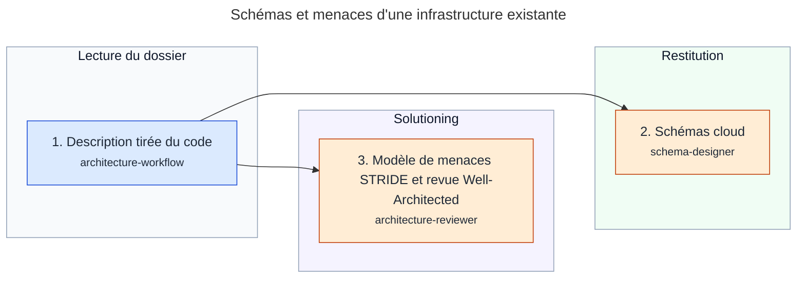

<!-- Fichier généré par scripts/build.py depuis skills/decision-log/workflows/cloud-existant.json : ne pas le modifier à la main. -->

# Schémas et menaces d'une infrastructure existante

Workflow `cloud-existant` : 3 étapes, dont 0 facultatives. Point de départ : code d'infrastructure. [Tous les workflows](README.md).

## À quoi il sert

Du code d'infrastructure (Terraform, docker-compose, Kubernetes) au schéma cloud relu, puis au modèle de menaces STRIDE et à la revue Well-Architected du fournisseur.

## Ce que le moteur demande au départ

- Le vault Obsidian qui sert de mémoire partagée (sans réponse : workflow sans vault)
- Le dossier du code d'infrastructure, s'il n'est pas dans infra/

## Déroulé

En bleu, les étapes menées par le moteur `architecture-workflow` ; en orange, celles qu'il confie à un agent spécialisé ; en tirets, les étapes facultatives (l'utilisateur peut les passer). Les étapes sont rangées par zone : lecture du dossier, cadrage, solutioning, chiffrage, restitution. Chaque étape s'arrête pour la revue de l'utilisateur avant la suite.

Étapes prêtes en même temps, menées en parallèle :
- 2. Schémas cloud, 3. Modèle de menaces STRIDE et revue Well-Architected

## Étapes

| Étape | Zone | Niveau | Menée par | Skills | Livrables | Après |
| --- | --- | --- | --- | --- | --- | --- |
| 1. Description tirée du code | Lecture du dossier | moyen | `architecture-workflow` | `cloud-architecture` | `schemas/architecture.json` | début |
| 2. Schémas cloud | Restitution | simple | `schema-designer` | `cloud-architecture`, `diagram-export` | `schemas/architecture.drawio`, `schemas/*.png` | 1 |
| 3. Modèle de menaces STRIDE et revue Well-Architected | Solutioning | complexe | `architecture-reviewer` | `threat-model`, `well-architected-review` | `schemas/architecture.threats.md`, `schemas/architecture.wa.md` | 1 |

### 1. Description tirée du code

- **Entrées** : `infra/**/*`
- **Livrables** : `schemas/architecture.json`
- **Contrôle** : cloud-architecture : iac_import.py <sources> --out schemas/architecture.json

Compléter la description produite : titre, acteurs externes, protocoles et ports, flux que le code ne montre pas ; vérifier le sens des flux. Chaque flux ajouté sans source dans le code se note au journal comme hypothèse.

### 2. Schémas cloud

- **Entrées** : `schemas/architecture.json`
- **Livrables** : `schemas/architecture.drawio`, `schemas/*.png`
- **Livrables possibles** : `schemas/architecture.flows.md`
- **Contrôle** : cloud-architecture : cloud_build.py schemas/architecture.json --matrix --export png (construit, vérifie et exporte en un appel), puis relire l'image une fois

### 3. Modèle de menaces STRIDE et revue Well-Architected

- **Entrées** : `schemas/architecture.json`
- **Livrables** : `schemas/architecture.threats.md`, `schemas/architecture.wa.md`
- **Livrables possibles** : `schemas/architecture.decisions.json`
- **Contrôle** : threat-model : stride.py schemas/architecture.json, avec --vault <vault> --folder <dossier> si le workflow a un vault
- **Contrôle** : threat-model : threat_review.py schemas/architecture.decisions.json (décisions sur les menaces : statut, mesure retenue, raison ; le tableau ne se réécrit pas à la main)
- **Contrôle** : well-architected-review : wa_check.py schemas/architecture.json --fail-on moyenne (piliers et conventions du schéma), avec --vault <vault> --folder <dossier> si le workflow a un vault

Compléter mesures et statuts des menaces avec l'utilisateur à la revue. Constats Well-Architected : corriger la description, ou les accepter dans accept avec la raison donnée par l'utilisateur.
