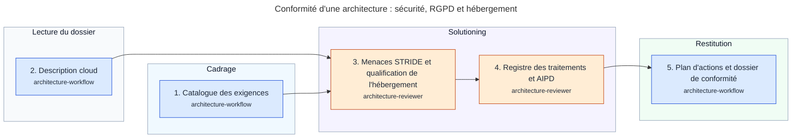

<!-- Fichier généré par scripts/build.py depuis skills/decision-log/workflows/conformite.json : ne pas le modifier à la main. -->

# Conformité d'une architecture : sécurité, RGPD et hébergement

Workflow `conformite` : 5 étapes, dont 0 facultatives. Point de départ : documents du projet. [Tous les workflows](README.md).

## À quoi il sert

Des exigences et de la description cloud d'une solution (existante ou retenue) au dossier de conformité : modèle de menaces STRIDE, revue Well-Architected avec la qualification de l'hébergeur (SecNumCloud), registre des traitements et analyse d'impact (AIPD) RGPD, puis le plan d'actions qui en découle.

## Ce que le moteur demande au départ

- Le vault Obsidian qui sert de mémoire partagée (sans réponse : workflow sans vault)
- La description cloud (schemas/architecture.json) ou le dossier du code d'infrastructure, s'il n'est pas dans infra/
- Le responsable du traitement et le délégué à la protection des données (sans réponse : à compléter au registre)

## Déroulé

En bleu, les étapes menées par le moteur `architecture-workflow` ; en orange, celles qu'il confie à un agent spécialisé ; en tirets, les étapes facultatives (l'utilisateur peut les passer). Les étapes sont rangées par zone : lecture du dossier, cadrage, solutioning, chiffrage, restitution. Chaque étape s'arrête pour la revue de l'utilisateur avant la suite.

Étapes prêtes en même temps, menées en parallèle :
- 1. Catalogue des exigences, 2. Description cloud

## Étapes

| Étape | Zone | Niveau | Menée par | Skills | Livrables | Après |
| --- | --- | --- | --- | --- | --- | --- |
| 1. Catalogue des exigences | Cadrage | moyen | `architecture-workflow` | `doc-to-markdown`, `requirements-catalog` | `donnees/exigences.json`, `exigences.md` | début |
| 2. Description cloud | Lecture du dossier | moyen | `architecture-workflow` | `cloud-architecture`, `diagram-export` | `schemas/architecture.json`, `schemas/architecture.drawio`, `schemas/*.png` | début |
| 3. Menaces STRIDE et qualification de l'hébergement | Solutioning | complexe | `architecture-reviewer` | `threat-model`, `well-architected-review` | `schemas/architecture.threats.md`, `schemas/architecture.wa.md` | 1, 2 |
| 4. Registre des traitements et AIPD | Solutioning | complexe | `architecture-reviewer` | `data-protection` | `donnees/aipd.json`, `aipd.registre.md`, `aipd.aipd.md` | 3 |
| 5. Plan d'actions et dossier de conformité | Restitution | moyen | `architecture-workflow` | `architecture-dossier` | `synthese.md`, `plan-actions.md`, `dossier-conformite.md` | 4 |

### 1. Catalogue des exigences

- **Entrées** : `documents/*`, `sources/*.md`
- **Livrables** : `donnees/exigences.json`, `exigences.md`
- **Livrables possibles** : `donnees/exigences.candidats.json`, `donnees/exigences.csv`, `donnees/exigences.tri.json`, `sources/*.md`
- **Contrôle** : doc-to-markdown : convert.py <documents> --out sources, puis validate.py sources (documents hors Markdown seulement)
- **Contrôle** : requirements-catalog : req_build.py donnees/exigences.json --candidates, tri des phrases par un sous-agent de niveau simple (donnees/exigences.tri.json), puis req_build.py donnees/exigences.json : zéro erreur et zéro phrase d'exigence non reprise

Convertir d'abord les documents qui ne sont pas en Markdown (vision ou plus de 5 documents : document-extractor). Écrire donnees/exigences.json (req_build.py donnees/exigences.json --draft en donne le brouillon, une exigence par phrase normative, à trier) en gardant les exigences de sécurité, de protection des données, d'hébergement et de réversibilité avec leur numérotation ; chaque exigence déduite se note au journal.

### 2. Description cloud

- **Entrées** : `schemas/architecture.json`, `infra/**/*`, `donnees/exigences.json`
- **Livrables** : `schemas/architecture.json`, `schemas/architecture.drawio`, `schemas/*.png`
- **Contrôle** : cloud-architecture : iac_import.py <sources> --out schemas/architecture.json (seulement sans description fournie)
- **Contrôle** : cloud-architecture : cloud_build.py schemas/architecture.json --matrix --export png (construit, vérifie et exporte en un appel), puis relire l'image une fois

Reprendre la description fournie, ou celle tirée du code, et la compléter : hébergeur (provider, y compris souverain), données personnelles portées par chaque flux dans son libellé, flux vers des tiers et leur pays. Chaque flux ajouté sans source se note au journal comme hypothèse.

### 3. Menaces STRIDE et qualification de l'hébergement

- **Entrées** : `schemas/architecture.json`, `donnees/exigences.json`
- **Livrables** : `schemas/architecture.threats.md`, `schemas/architecture.wa.md`
- **Livrables possibles** : `schemas/architecture.decisions.json`
- **Contrôle** : threat-model : stride.py schemas/architecture.json, avec --vault <vault> --folder <dossier> si le workflow a un vault
- **Contrôle** : threat-model : threat_review.py schemas/architecture.decisions.json (décisions sur les menaces : statut, mesure retenue, raison ; le tableau ne se réécrit pas à la main)
- **Contrôle** : well-architected-review : wa_check.py schemas/architecture.json --fail-on moyenne (dont SEC-08 : qualification SecNumCloud exigée et absente chez l'hébergeur), avec --vault <vault> --folder <dossier> si le workflow a un vault

Garder les menaces pertinentes et leur mesure ; une qualification exigée que l'hébergeur n'a pas ne s'accepte qu'avec la raison de l'utilisateur, notée au journal. Les numéros des menaces (M001...) servent de références aux mesures de l'AIPD.

### 4. Registre des traitements et AIPD

- **Entrées** : `donnees/exigences.json`, `schemas/architecture.json`, `schemas/architecture.threats.md`
- **Livrables** : `donnees/aipd.json`, `aipd.registre.md`, `aipd.aipd.md`
- **Contrôle** : data-protection : dpia_build.py donnees/aipd.json, avec --vault <vault> --folder <dossier> si le workflow a un vault (zéro erreur ; mesures reliées aux exigences et aux menaces)

donnees/aipd.json reprend l'hébergeur de la description, requirements (donnees/exigences.json) et threats (schemas/architecture.threats.md) ; un traitement par finalité, avec ses flux. Les critères du CEPD, la gravité et la vraisemblance demandent du jugement : chacun se justifie dans la description. Un risque résiduel élevé reste ouvert et se note au journal --kind question (consultation préalable de la CNIL).

### 5. Plan d'actions et dossier de conformité

- **Entrées** : `schemas/architecture.threats.md`, `schemas/architecture.wa.md`, `aipd.aipd.md`, `journal.md`
- **Livrables** : `synthese.md`, `plan-actions.md`, `dossier-conformite.md`
- **Livrables possibles** : `donnees/plan-actions.csv`
- **Contrôle** : architecture-dossier : actions.py . (plan-actions.md et donnees/plan-actions.csv tirés des menaces, constats et risques ; --assign pour les responsables et échéances donnés par l'utilisateur)
- **Contrôle** : architecture-dossier : dossier_build.py . --template conformite --out dossier-conformite.md --strict (sections obligatoires présentes, liens et images vérifiés)
- **Contrôle** : si l'utilisateur veut un Word ou un PDF : passer dossier-conformite.md à document-publisher

plan-actions.md se construit avec actions.py, sans relire les revues : une action par règle ou mesure, priorité tirée de la gravité ; seuls responsables et échéances donnés par l'utilisateur vont dans --assign. Les menaces encore sans mesure retenue se règlent à l'étape menaces, pas ici. synthese.md tient en une page : périmètre, hébergement, AIPD requise ou non, risques ouverts, décisions attendues. Le reste est assemblé par le script.

## Mémoire partagée

Fichiers que le moteur reporte dans le vault Obsidian, quand le workflow en a un :

- requirements : `donnees/exigences.json`
