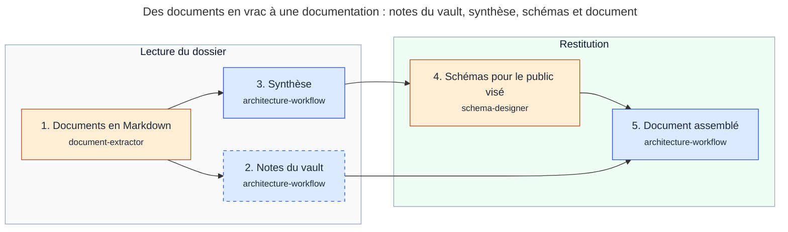

<!-- Fichier généré par scripts/build.py depuis skills/decision-log/workflows/documentation.json : ne pas le modifier à la main. -->

# Des documents en vrac à une documentation : notes du vault, synthèse, schémas et document

Workflow `documentation` : 5 étapes, dont 1 facultatives. Point de départ : documents du projet. [Tous les workflows](README.md).

## À quoi il sert

Workflow de documentation de l'agent architecture-workflow : documents hétérogènes (PDF, Office, images, vidéos) en Markdown, notes rangées dans le vault Obsidian avec leur index, synthèse pour le public visé dont chaque point cite son document, schémas au format choisi selon le public et la destination, puis un document assemblé à publier en Word, PDF ou Confluence ; une porte de revue par étape.

## Ce que le moteur demande au départ

- Le vault Obsidian qui sert de mémoire partagée (sans réponse : workflow sans vault)
- Le public du document (technique, non technique, mixte) et sa destination (Markdown, Obsidian, Word, PDF, Confluence, PowerPoint) ; sans réponse : public mixte et Word, hypothèse notée au journal

## Déroulé

En bleu, les étapes menées par le moteur `architecture-workflow` ; en orange, celles qu'il confie à un agent spécialisé ; en tirets, les étapes facultatives (l'utilisateur peut les passer). Les étapes sont rangées par zone : lecture du dossier, cadrage, solutioning, chiffrage, restitution. Chaque étape s'arrête pour la revue de l'utilisateur avant la suite.

Étapes prêtes en même temps, menées en parallèle :
- 2. Notes du vault, 3. Synthèse

## Étapes

| Étape | Zone | Niveau | Menée par | Skills | Livrables | Après |
| --- | --- | --- | --- | --- | --- | --- |
| 1. Documents en Markdown | Lecture du dossier | simple | `document-extractor` | `doc-to-markdown` | `sources/*.md` | début |
| 2. Notes du vault (facultative) | Lecture du dossier | simple | `architecture-workflow` | `markdown-to-obsidian` | `index.md` | 1 |
| 3. Synthèse | Lecture du dossier | moyen | `architecture-workflow` | `doc-to-markdown` | `synthese.md` | 1 |
| 4. Schémas pour le public visé | Restitution | moyen | `schema-designer` | `diagram-brief`, `excalidraw-diagram`, `mermaid-diagram`, `drawio-diagram`, `diagram-export` | `schemas/briefs/*.json`, `schemas/**/*.png` | 3 |
| 5. Document assemblé | Restitution | simple | `architecture-workflow` | `architecture-dossier` | `documentation.md` | 4, 2 |

### 1. Documents en Markdown

- **Entrées** : `documents/*`
- **Livrables** : `sources/*.md`
- **Contrôle** : doc-to-markdown : convert.py <documents> --out sources (--triage TRI.json si l'utilisateur veut le tri, voir classify.py --candidates), puis validate.py sources

Documents nommés par l'utilisateur, sinon ceux de documents/, convertis en une commande ; un document déjà en Markdown est copié tel quel dans sources/. Les pages de vision_pages sont transcrites par la vision ; à partir de 5 documents à transcrire, passer la main à document-extractor. Un document écarté se note au journal avec sa raison.

### 2. Notes du vault

- **Entrées** : `sources/*.md`
- **Livrables** : `index.md`
- **Contrôle** : markdown-to-obsidian : obsidianize.py index.md sources/*.md --vault <vault> --folder <dossier> (notes copiées dans le vault, sources/ inchangé), puis vault_check.py <vault> --folder <dossier>

Étape facultative, proposée seulement si le workflow a un vault (ou dans une mission) ; sans vault, la sauter (skip) : sources/, validé, serait réécrit en place. index.md : un titre, puis une ligne par document, un lien Markdown vers sources/<nom>.md et son objet en une phrase tiré de son titre et de ses intertitres. Les notes vont dans le dossier du workflow du vault. Rien à écrire : démarrer, contrôler et soumettre en un appel (journal.py start DOSSIER notes --submit).

### 3. Synthèse

- **Entrées** : `sources/*.md`
- **Livrables** : `synthese.md`
- **Contrôle** : doc-to-markdown : validate.py synthese.md (liens vers les documents et images vérifiés)

Une à deux pages pour le public donné à l'ouverture : objet, points clés, chiffres, décisions prises et questions ouvertes, dans les mots du public (sigles expliqués pour un public non technique). Chaque point cite son document par un lien vers sources/<nom>.md ; lire chaque source une seule fois. Une contradiction entre documents se signale dans les questions ouvertes ; un point sans source se note au journal comme hypothèse. À la revue, présenter les points clés et les questions ouvertes.

### 4. Schémas pour le public visé

- **Entrées** : `synthese.md`
- **Livrables** : `schemas/briefs/*.json`, `schemas/**/*.png`
- **Livrables possibles** : `schemas/decisions/*.json`, `schemas/excalidraw/*`, `schemas/mermaid/*`, `schemas/drawio/*`
- **Contrôle** : diagram-brief : brief.py schemas/briefs/<nom>.json --out schemas/decisions/<nom>.json pour chaque schéma (public, destination, type, message, 3 à 7 éléments) : il choisit le format et le skill
- **Contrôle** : selon la décision, une description par schéma dans le dossier de son format : excalidraw-diagram : excalidraw_build.py schemas/excalidraw/<nom>.json --export png ; mermaid-diagram : mermaid_build.py schemas/mermaid/<nom>.json --out schemas/mermaid/<nom>.mmd puis diagram-export : export.py en PNG ; drawio-diagram : drawio_build.py schemas/drawio/<nom>.json --export png
- **Contrôle** : relire chaque PNG une fois

Un à trois schémas, chacun avec un seul message. Le brief de chaque schéma (diagram-brief) fixe le format et le skill selon le public et la destination : pour un public non technique, une vue d'ensemble Excalidraw ; pour un public technique, un schéma de flux ou de séquence (Mermaid) ou d'architecture (draw.io) ; une vue C4 détaillée passe à schema-designer. La description ne reprend que les éléments du brief ; un élément laissé de côté se dit dans left_out. Les constructions sont mécaniques et restent à l'agent du workflow ; un schéma détaillé demandé par l'utilisateur passe à schema-designer.

### 5. Document assemblé

- **Entrées** : `synthese.md`, `schemas/**/*.png`, `index.md`, `sources/*.md`
- **Livrables** : `documentation.md`
- **Contrôle** : architecture-dossier : dossier_build.py . --template documentation --out documentation.md --strict (synthèse présente, liens et images vérifiés)
- **Contrôle** : si l'utilisateur veut un Word, un PDF, une page Confluence ou XWiki, ou une présentation : passer documentation.md à document-publisher

Assemblage mécanique par le script : synthèse, schémas, index et annexe des documents, sans réécrire la synthèse validée. La publication (Word, PDF, Confluence, PowerPoint) passe à document-publisher, qui produit les fichiers sans rien mettre en ligne. Rien à écrire : démarrer, contrôler et soumettre en un appel (journal.py start DOSSIER document --submit).
