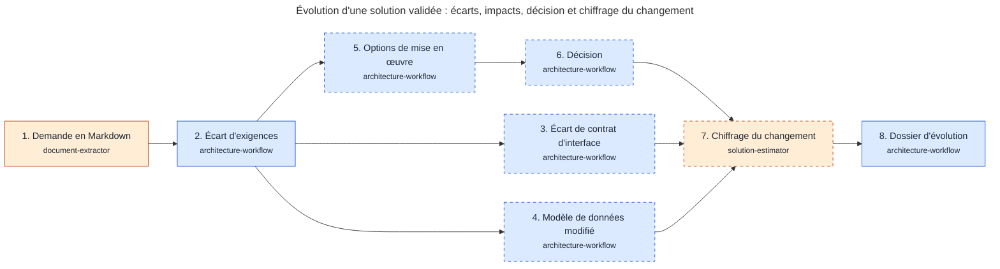

<!-- Fichier généré par scripts/build.py depuis skills/decision-log/workflows/evolution.json : ne pas le modifier à la main. -->

# Évolution d'une solution validée : écarts, impacts, décision et chiffrage du changement

Workflow `evolution` : 8 étapes, dont 5 facultatives. Point de départ : dossier validé. [Tous les workflows](README.md).

## À quoi il sert

Workflow d'évolution de l'agent architecture-workflow, mené dans un sous-dossier d'un dossier aux étapes validées : demande de changement en Markdown, copie de travail du catalogue d'exigences et écart calculé (ajoutées, modifiées, retirées, contextes bornés touchés), au choix l'écart de contrat d'interface (ruptures et version à monter) et le modèle de données modifié, au choix 2 options de mise en œuvre situées dans le SI et la décision (ADR), au choix le chiffrage du seul changement, puis le dossier d'évolution ; une porte de revue par étape.

## Ce que le moteur demande au départ

- Le dossier validé qui évolue (défaut : le dossier parent) ; évolution menée dans son sous-dossier evolution/ (ou evolution-<nom>/ s'il y en a plusieurs)
- Le vault Obsidian qui sert de mémoire partagée (sans réponse : workflow sans vault)

## Déroulé

En bleu, les étapes menées par le moteur `architecture-workflow` ; en orange, celles qu'il confie à un agent spécialisé ; en tirets, les étapes facultatives (l'utilisateur peut les passer). Chaque étape s'arrête pour la revue de l'utilisateur avant la suite.

Étapes prêtes en même temps, menées en parallèle :
- 3. Écart de contrat d'interface, 4. Modèle de données modifié, 5. Options de mise en œuvre

## Étapes

| Étape | Niveau | Menée par | Skills | Livrables | Après |
| --- | --- | --- | --- | --- | --- |
| 1. Demande en Markdown | simple | `document-extractor` | `doc-to-markdown` | `sources/*.md` | début |
| 2. Écart d'exigences | moyen | `architecture-workflow` | `requirements-catalog` | `exigences.json`, `exigences.md`, `ecarts-exigences.md` | 1 |
| 3. Écart de contrat d'interface (facultative) | moyen | `architecture-workflow` | `api-contract` | `api.json`, `ecarts-api.md` | 2 |
| 4. Modèle de données modifié (facultative) | moyen | `architecture-workflow` | `data-model` | `modele.json`, `modele.md` | 2 |
| 5. Options de mise en œuvre (facultative) | complexe | `architecture-workflow` | `architecture-options`, `urbanization-map`, `well-architected-review` | `options.json`, `options.md` | 2 |
| 6. Décision (facultative) | simple | `architecture-workflow` | `architecture-options` | `decision.json`, `adr-architecture.md` | 5 |
| 7. Chiffrage du changement (facultative) | complexe | `solution-estimator` | `solution-estimate`, `cloud-cost` | `chiffrage.json`, `chiffrage.md` | 6, 3, 4 |
| 8. Dossier d'évolution | simple | `architecture-workflow` | `architecture-dossier` | `synthese.md`, `dossier-evolution.md` | 7 |

### 1. Demande en Markdown

- **Entrées** : `documents/*`
- **Livrables** : `sources/*.md`
- **Contrôle** : doc-to-markdown : convert.py <documents> --out sources (--classify si l'utilisateur veut le tri), puis validate.py sources

Documents de la demande de changement (évolution, nouvelle réglementation, retour d'usage) nommés par l'utilisateur, sinon ceux de documents/ du sous-dossier, convertis en une commande ; un document déjà en Markdown est copié tel quel dans sources/. Une demande dite oralement s'écrit dans sources/demande.md avec les mots de l'utilisateur. Un document écarté se note au journal avec sa raison.

### 2. Écart d'exigences

- **Entrées** : `sources/*.md`, `../exigences.json`, `../domaines.json`
- **Livrables** : `exigences.json`, `exigences.md`, `ecarts-exigences.md`
- **Livrables possibles** : `exigences.csv`
- **Contrôle** : requirements-catalog : req_diff.py ../exigences.json exigences.json --start (copie de travail), puis req_build.py exigences.json et req_diff.py ../exigences.json exigences.json --out ecarts-exigences.md, avec --domains ../domaines.json si le dossier a un découpage

Ne jamais modifier ../exigences.json, validé. Dans la copie de travail : chaque exigence ajoutée cite la demande (sources/), chaque modification garde son identifiant, une exigence abandonnée passe en status écartée avec sa raison. À la revue, présenter l'écart (ajoutées, modifiées, retirées) et les contextes touchés ; une exigence ajoutée sans contexte se rattache à un contexte ou se signale comme nouveau périmètre.

### 3. Écart de contrat d'interface

- **Entrées** : `ecarts-exigences.md`, `../api.json`, `../api/api.json`
- **Livrables** : `api.json`, `ecarts-api.md`
- **Livrables possibles** : `api.openapi.yaml`, `api.asyncapi.yaml`, `api.api.md`
- **Contrôle** : api-contract : api_diff.py <contrat validé : ../api.json ou ../api/api.json> api.json --start, puis api_build.py api.json et api_diff.py <contrat validé> api.json --out ecarts-api.md (ruptures et version à monter)

Étape facultative, proposée si le dossier a un contrat d'interface et que la demande touche une exigence portée par une opération ou un événement : l'utilisateur dit s'il la veut (start) ou non (skip). Dans la copie, requirements vise exigences.json (la copie de travail) et source.options ../options.json. Une rupture s'évite d'abord (opération ajoutée, champ facultatif, ancienne version gardée) ; une rupture gardée se justifie au journal et la version majeure monte.

### 4. Modèle de données modifié

- **Entrées** : `ecarts-exigences.md`, `../modele.json`, `../domaines.json`
- **Livrables** : `modele.json`, `modele.md`
- **Livrables possibles** : `modele.mmd`, `modele.sql`
- **Contrôle** : data-model : model_build.py modele.json (copie du modèle validé modifiée ; avec domains, aucune clé étrangère entre contextes)

Étape facultative, proposée si la demande ajoute ou change des données : l'utilisateur dit s'il la veut (start) ou non (skip). Copier le modèle validé (python -c "import shutil; shutil.copy('../modele.json', 'modele.json')"), puis ne changer que les entités et champs de la demande, chacun avec la référence de son exigence ; requirements vise exigences.json et domains ../domaines.json. Une donnée personnelle nouvelle se signale à la revue (registre, AIPD : data-protection).

### 5. Options de mise en œuvre

- **Entrées** : `exigences.json`, `ecarts-exigences.md`, `../options.json`, `../decision.json`, `documents/pos*`
- **Livrables** : `options.json`, `options.md`
- **Livrables possibles** : `tracabilite.md`, `schemas/pos-option-*.json`
- **Contrôle** : architecture-options : options_build.py options.json (placement dans le POS si le dossier en a un)

Étape facultative, proposée quand le changement peut se faire de plusieurs façons (faire évoluer un composant existant, ajouter un service, acheter) : l'utilisateur dit s'il la veut (start) ou non (skip). 2 options au plus, chacune partant des composants de l'option retenue (../options.json, ../decision.json) avec ce qui change ; requirements vise exigences.json. Critères tirés des exigences ajoutées ou modifiées, plus l'effort de non-régression. À la revue, présenter l'option recommandée et le choix à faire.

### 6. Décision

- **Entrées** : `options.json`
- **Livrables** : `decision.json`, `adr-architecture.md`
- **Livrables possibles** : `tracabilite.md`, `tracabilite.csv`
- **Contrôle** : architecture-options : options_build.py options.json --decision decision.json

decision.json reprend le choix fait par l'utilisateur à la revue des options : option, by, ses mots dans why, date, refs. Sautée si l'étape options l'a été.

### 7. Chiffrage du changement

- **Entrées** : `exigences.json`, `ecarts-exigences.md`, `ecarts-api.md`, `options.json`, `decision.json`
- **Livrables** : `chiffrage.json`, `chiffrage.md`
- **Livrables possibles** : `chiffrage.csv`, `couts.json`, `couts.md`, `couts.csv`
- **Contrôle** : cloud-cost : cost_build.py couts.json --infra <option> pour une option cloud (coût de run calculé sur la grille locale ; ses lignes vont dans infra de chiffrage.json)
- **Contrôle** : solution-estimate : estimate_build.py chiffrage.json, avec --vault <vault> --folder <dossier> si le workflow a un vault (zéro erreur ; hébergeur et qualifications exigées vérifiés)

Étape facultative : l'utilisateur dit s'il la veut (start) ou non (skip, avec ses mots). Seul le changement se chiffre : un lot par exigence ajoutée ou modifiée et par rupture de contrat à gérer (ancienne version gardée, clients à migrer), plus la recette de non-régression ; les exigences inchangées n'entrent pas. Demander une seule fois les taux journaliers ; sans réponse, chaque valeur prise est une hypothèse notée au journal. Le découpage et les estimations à trois points passent à solution-estimator ; totaux et fourchette sont calculés par le script.

### 8. Dossier d'évolution

- **Entrées** : `ecarts-exigences.md`, `ecarts-api.md`, `modele.md`, `options.md`, `adr-architecture.md`, `chiffrage.md`, `journal.md`
- **Livrables** : `synthese.md`, `dossier-evolution.md`
- **Contrôle** : architecture-dossier : dossier_build.py . --template evolution --out dossier-evolution.md --strict
- **Contrôle** : si l'utilisateur veut un Word ou un PDF : passer dossier-evolution.md à document-publisher

Écrire synthese.md (une page : la demande, les exigences touchées, les impacts sur les contrats, les données et le SI, l'option retenue, le coût du changement, les ruptures et leurs conditions) à partir des rapports des étapes, sans relire les livrables ; le reste est assemblé par le script.

## Mémoire partagée

Fichiers que le moteur reporte dans le vault Obsidian, quand le workflow en a un :

- requirements : `exigences.json`
- options : `options.json`
- decision : `decision.json`
- adr : `adr-architecture.md`
