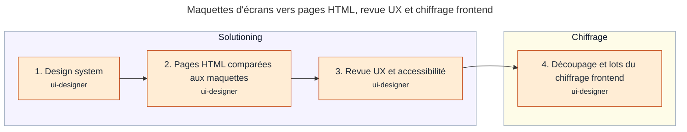

<!-- Fichier généré par scripts/build.py depuis skills/decision-log/workflows/maquettes.json : ne pas le modifier à la main. -->

# Maquettes d'écrans vers pages HTML, revue UX et chiffrage frontend

Workflow `maquettes` : 4 étapes, dont 0 facultatives. Point de départ : maquettes d'écrans. [Tous les workflows](README.md).

## À quoi il sert

Workflow des maquettes de l'agent architecture-workflow : design system tiré des maquettes ou repris du client, une page HTML mesurée et comparée bloc par bloc par écran, revue UX et accessibilité, puis découpage en composants et lots du chiffrage frontend, constats UX retenus compris ; une porte de revue par étape.

## Ce que le moteur demande au départ

- Le vault Obsidian qui sert de mémoire partagée (sans réponse : workflow sans vault)
- La bibliothèque visée (html, bootstrap, react-mui, react-antd, vue-vuetify, angular-material) et les tokens du client s'il en a (sans réponse : html et design system tiré des maquettes, hypothèse notée au journal)

## Déroulé

En bleu, les étapes menées par le moteur `architecture-workflow` ; en orange, celles qu'il confie à un agent spécialisé ; en tirets, les étapes facultatives (l'utilisateur peut les passer). Les étapes sont rangées par zone : lecture du dossier, cadrage, solutioning, chiffrage, restitution. Chaque étape s'arrête pour la revue de l'utilisateur avant la suite.

## Étapes

| Étape | Zone | Niveau | Menée par | Skills | Livrables | Après |
| --- | --- | --- | --- | --- | --- | --- |
| 1. Design system | Solutioning | moyen | `ui-designer` | `design-system` | `design-system.json` | début |
| 2. Pages HTML comparées aux maquettes | Solutioning | moyen | `ui-designer` | `mockup-to-html`, `design-system` | `pages/*.json`, `pages/*.html`, `pages/*.css` | 1 |
| 3. Revue UX et accessibilité | Solutioning | moyen | `ui-designer` | `mockup-to-html` | `donnees/revue-ux.json`, `pages/*.ux.md` | 2 |
| 4. Découpage et lots du chiffrage frontend | Chiffrage | moyen | `ui-designer` | `mockup-to-html` | `decoupage.md`, `donnees/decoupage.lots.json` | 3 |

### 1. Design system

- **Entrées** : `maquettes/*`
- **Livrables** : `design-system.json`
- **Livrables possibles** : `design-system.css`, `design-system.md`
- **Contrôle** : design-system : ds_import.py <tokens du client> --out design-system.json s'il en fournit, sinon ds_extract.py maquettes/*.png --draft design-system.json, puis ds_build.py design-system.json

Tokens du client repris tels quels (source verrouillée) ; sinon ébauche tirée des maquettes, rôles des couleurs relus (primaire, texte, surface, danger). Une couleur ou un espacement sans source se note au journal comme hypothèse.

### 2. Pages HTML comparées aux maquettes

- **Entrées** : `maquettes/*`, `design-system.json`
- **Livrables** : `pages/*.json`, `pages/*.html`, `pages/*.css`
- **Livrables possibles** : `analyses/*.analysis.json`, `pages/*.compare.png`, `pages/*.render.png`, `pages/assets/*`
- **Contrôle** : mockup-to-html : ui_analyze.py maquettes/*.png --tokens design-system.json --draft --out-dir analyses, ébauches relues et rangées dans pages/
- **Contrôle** : mockup-to-html : page_build.py pages/<écran>.json --min-fidelity 0.85 pour chaque écran (écarts rattachés aux nœuds, à corriger dans la description)

Une description par écran dans pages/ (les analyses restent dans analyses/), partie de l'ébauche mesurée, jamais du HTML écrit à la main. Corriger les écarts signalés nœud par nœud ; une fidélité sous le seuil acceptée se note au journal avec sa raison. Un état d'écran ou un contenu masqué que la maquette ne montre pas est une question pour l'utilisateur.

### 3. Revue UX et accessibilité

- **Entrées** : `pages/*.json`
- **Livrables** : `donnees/revue-ux.json`, `pages/*.ux.md`
- **Contrôle** : mockup-to-html : ux_review.py donnees/revue-ux.json (contrôles WCAG sur le rendu, puis constats de jugement validés : heuristique, gravité, nœud)

Premier passage avec findings vide pour les contrôles mécaniques, puis constats de jugement (heuristiques de Nielsen h1 à h10, a11y), un par problème, gravité 1 à 4, rattachés au nœud. L'utilisateur retient ou écarte les constats à la revue : ceux qui restent dans donnees/revue-ux.json sont chiffrés à l'étape suivante.

### 4. Découpage et lots du chiffrage frontend

- **Entrées** : `pages/*.json`, `donnees/revue-ux.json`
- **Livrables** : `decoupage.md`, `donnees/decoupage.lots.json`
- **Livrables possibles** : `donnees/decoupage.json`, `donnees/decoupage.csv`
- **Contrôle** : mockup-to-html : ui_breakdown.py pages/*.json --out donnees/decoupage --ux donnees/revue-ux.json, avec --target et --component si connus (lots contrôlés contre le schéma de solution-estimate)

Relire les lots : réemploi d'un écran qui ne ressemble pas à sa source à retirer, réemploi manquant à ajouter avec sa base ; toute correction a sa note au journal. Si calibrated est faux, dire que les charges viennent d'abaques par défaut. Pour un chiffrage complet, donnees/decoupage.lots.json passe à solution-estimate (estimate_build.py --draft --lots donnees/decoupage.lots.json).
