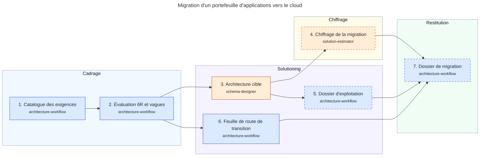

<!-- Fichier généré par scripts/build.py depuis skills/decision-log/workflows/migration-cloud.json : ne pas le modifier à la main. -->

# Migration d'un portefeuille d'applications vers le cloud

Workflow `migration-cloud` : 7 étapes, dont 3 facultatives. Point de départ : documents du projet. [Tous les workflows](README.md).

## À quoi il sert

D'un inventaire d'applications à la trajectoire de migration : exigences, évaluation 6R de chaque application et vagues calculées, architecture cible relue (Well-Architected, hébergeur), au choix le chiffrage et le dossier d'exploitation, puis la feuille de route avec chemin critique et, au choix, le dossier de migration.

## Ce que le moteur demande au départ

- Le vault Obsidian qui sert de mémoire partagée (sans réponse : workflow sans vault)
- L'inventaire des applications (CSV, POS d'urbanization-map ou documents), s'il n'est pas dans documents/
- L'hébergeur cible et l'échéance de la migration (sans réponse : hypothèses notées au journal)

## Déroulé

En bleu, les étapes menées par le moteur `architecture-workflow` ; en orange, celles qu'il confie à un agent spécialisé ; en tirets, les étapes facultatives (l'utilisateur peut les passer). Les étapes sont rangées par zone : lecture du dossier, cadrage, solutioning, chiffrage, restitution. Chaque étape s'arrête pour la revue de l'utilisateur avant la suite.

Étapes prêtes en même temps, menées en parallèle :
- 3. Architecture cible, 6. Feuille de route de transition
- 4. Chiffrage de la migration, 5. Dossier d'exploitation

## Étapes

| Étape | Zone | Niveau | Menée par | Skills | Livrables | Après |
| --- | --- | --- | --- | --- | --- | --- |
| 1. Catalogue des exigences | Cadrage | moyen | `architecture-workflow` | `doc-to-markdown`, `requirements-catalog` | `donnees/exigences.json`, `exigences.md` | début |
| 2. Évaluation 6R et vagues | Cadrage | complexe | `architecture-workflow` | `migration-assessment`, `urbanization-map` | `donnees/migration.json`, `migration.md`, `donnees/migration.waves.json` | 1 |
| 3. Architecture cible | Solutioning | complexe | `schema-designer` | `cloud-architecture`, `well-architected-review`, `diagram-export` | `schemas/cible.json`, `schemas/cible.drawio`, `schemas/*.png`, `schemas/cible.wa.md` | 2 |
| 4. Chiffrage de la migration (facultative) | Chiffrage | complexe | `solution-estimator` | `solution-estimate`, `cloud-cost` | `donnees/chiffrage.json`, `chiffrage.md` | 3 |
| 5. Dossier d'exploitation (facultative) | Solutioning | moyen | `architecture-workflow` | `operations-dossier` | `donnees/exploitation.json`, `exploitation.md` | 3 |
| 6. Feuille de route de transition | Solutioning | moyen | `architecture-workflow` | `transition-roadmap`, `diagram-export` | `donnees/feuille-de-route.json`, `feuille-de-route.md` | 2 |
| 7. Dossier de migration (facultative) | Restitution | simple | `architecture-workflow` | `architecture-dossier` | `synthese.md`, `dossier-migration.md` | 4, 6, 5 |

### 1. Catalogue des exigences

- **Entrées** : `documents/*`, `sources/*.md`
- **Livrables** : `donnees/exigences.json`, `exigences.md`
- **Livrables possibles** : `donnees/exigences.candidats.json`, `donnees/exigences.csv`, `donnees/exigences.tri.json`, `sources/*.md`
- **Contrôle** : doc-to-markdown : convert.py <documents> --out sources, puis validate.py sources (documents hors Markdown seulement)
- **Contrôle** : requirements-catalog : req_build.py donnees/exigences.json --candidates, tri des phrases par un sous-agent de niveau simple (donnees/exigences.tri.json), puis req_build.py donnees/exigences.json : zéro erreur et zéro phrase d'exigence non reprise

Convertir d'abord les documents qui ne sont pas en Markdown (vision ou plus de 5 documents : document-extractor). Garder les exigences de migration : échéances, hébergement, réversibilité, continuité, contraintes de licence ; chaque exigence déduite se note au journal.

### 2. Évaluation 6R et vagues

- **Entrées** : `documents/inventaire*`, `documents/pos*`, `donnees/exigences.json`
- **Livrables** : `donnees/migration.json`, `migration.md`, `donnees/migration.waves.json`
- **Livrables possibles** : `donnees/migration.csv`
- **Contrôle** : migration-assessment : assess_build.py donnees/migration.json (zéro erreur ; dépendances, retraits et hébergeur cible contrôlés, vagues calculées)

Une entrée par application de l'inventaire, sans en inventer ; stratégie 6R, raison en une phrase, effort et risque. Chaque retrait et la stratégie de chaque application critique se présentent à la revue. Un avertissement gardé (refactor d'effort S, socle hors support réhébergé) se note au journal avec sa raison.

### 3. Architecture cible

- **Entrées** : `donnees/migration.json`, `donnees/exigences.json`
- **Livrables** : `schemas/cible.json`, `schemas/cible.drawio`, `schemas/*.png`, `schemas/cible.wa.md`
- **Contrôle** : cloud-architecture : cloud_build.py schemas/cible.json --matrix --export png (construit, vérifie et exporte en un appel), puis relire l'image une fois
- **Contrôle** : well-architected-review : wa_check.py schemas/cible.json --fail-on moyenne, avec --vault <vault> --folder <dossier> si le workflow a un vault

Décrire la cible des applications migrées avec l'hébergeur de donnees/migration.json : services cibles (target_service), réseau, identité, sauvegardes. Un constat Well-Architected de gravité haute se corrige ou s'accepte avec la raison de l'utilisateur.

### 4. Chiffrage de la migration

- **Entrées** : `donnees/migration.json`, `schemas/cible.json`, `donnees/exigences.json`
- **Livrables** : `donnees/chiffrage.json`, `chiffrage.md`
- **Livrables possibles** : `donnees/chiffrage.csv`, `donnees/couts.json`, `couts.md`, `donnees/couts.csv`
- **Contrôle** : cloud-cost : cost_build.py donnees/couts.json --infra <option> pour une option cloud (coût de run calculé sur la grille locale ; ses lignes vont dans infra de donnees/chiffrage.json)
- **Contrôle** : solution-estimate : estimate_build.py donnees/chiffrage.json, avec --vault <vault> --folder <dossier> si le workflow a un vault

Étape facultative : l'utilisateur dit s'il la veut (start) ou non (skip, avec ses mots). Un lot par vague ; les efforts S à XL de donnees/migration.json servent de base aux estimations à trois points.

### 5. Dossier d'exploitation

- **Entrées** : `schemas/cible.json`, `donnees/migration.json`, `donnees/exigences.json`
- **Livrables** : `donnees/exploitation.json`, `exploitation.md`
- **Contrôle** : operations-dossier : ops_build.py donnees/exploitation.json (zéro erreur ; indisponibilité permise calculée, sauvegardes confrontées au RPO, trous de couverture OPS-01 à OPS-10)

Étape facultative : l'utilisateur dit s'il la veut (start) ou non (skip, avec ses mots). Un service par composant de la cible qui porte un engagement ; disponibilité, RPO et RTO repris des exigences (requirements : donnees/exigences.json), jamais inventés : un engagement sans source se note au journal comme hypothèse. Un constat de gravité haute se corrige ou s'accepte avec la raison de l'utilisateur.

### 6. Feuille de route de transition

- **Entrées** : `donnees/migration.waves.json`, `donnees/exigences.json`
- **Livrables** : `donnees/feuille-de-route.json`, `feuille-de-route.md`
- **Livrables possibles** : `donnees/feuille-de-route.csv`, `feuille-de-route-*.png`
- **Contrôle** : transition-roadmap : roadmap_build.py donnees/feuille-de-route.json (zéro erreur ; chemin critique et échéance)
- **Contrôle** : si l'utilisateur veut une image : diagram-export : export.py feuille-de-route.md

Reprendre les vagues (waves.file : donnees/migration.waves.json) et ajouter les chantiers transverses : cadrage, socle, sécurité et AIPD, formation, décommissionnement, jalons. Échéance d'une exigence dans deadline. Une échéance dépassée se présente à la revue avec le chemin critique ; chaque durée prise sans source se note au journal comme hypothèse.

### 7. Dossier de migration

- **Entrées** : `migration.md`, `feuille-de-route.md`, `schemas/*.png`, `schemas/cible.wa.md`, `chiffrage.md`, `exploitation.md`, `journal.md`
- **Livrables** : `synthese.md`, `dossier-migration.md`
- **Livrables possibles** : `plan-actions.md`, `donnees/plan-actions.csv`
- **Contrôle** : architecture-dossier : actions.py . si une revue, des menaces ou une AIPD ont été faites (plan d'actions repris par le dossier)
- **Contrôle** : architecture-dossier : dossier_build.py . --template migration --out dossier-migration.md --strict
- **Contrôle** : si l'utilisateur veut un Word ou un PDF : passer dossier-migration.md à document-publisher

Étape facultative, proposée en dernier. Écrire synthese.md (une page : périmètre, répartition 6R, cible, coût, échéance et chemin critique, décisions attendues) à partir des rapports des étapes précédentes ; le reste est assemblé par le script.

## Mémoire partagée

Fichiers que le moteur reporte dans le vault Obsidian, quand le workflow en a un :

- requirements : `donnees/exigences.json`
