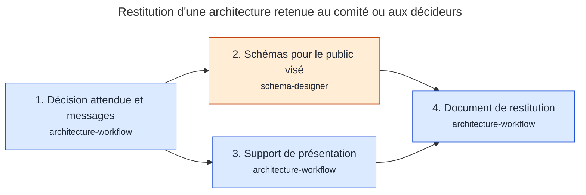

<!-- Fichier généré par scripts/build.py depuis skills/decision-log/workflows/restitution.json : ne pas le modifier à la main. -->

# Restitution d'une architecture retenue au comité ou aux décideurs

Workflow `restitution` : 4 étapes, dont 0 facultatives. Point de départ : dossier validé. [Tous les workflows](README.md).

## À quoi il sert

Workflow de restitution de l'agent architecture-workflow, mené dans un sous-dossier d'un dossier d'architecture aux étapes validées (architecture, cadrage, avant-vente, migration) : synthèse d'une page pour les décideurs (décision attendue, recommandation, coût, risques, suite), schémas choisis selon le public (vue d'ensemble pour un public non technique, vue de contexte), support de présentation et document assemblé ; une porte de revue par étape.

## Ce que le moteur demande au départ

- Le dossier d'architecture à restituer (défaut : le dossier parent, dont les étapes architectures et schémas sont validées) ; restitution menée dans son sous-dossier restitution/
- Le public (comité d'architecture, direction, métiers) et la décision attendue ; sans réponse : comité d'architecture et validation de l'option retenue, hypothèse notée au journal
- Le vault Obsidian qui sert de mémoire partagée (sans réponse : workflow sans vault)

## Déroulé

En bleu, les étapes menées par le moteur `architecture-workflow` ; en orange, celles qu'il confie à un agent spécialisé ; en tirets, les étapes facultatives (l'utilisateur peut les passer). Chaque étape s'arrête pour la revue de l'utilisateur avant la suite.

Étapes prêtes en même temps, menées en parallèle :
- 2. Schémas pour le public visé, 3. Support de présentation

## Étapes

| Étape | Niveau | Menée par | Skills | Livrables | Après |
| --- | --- | --- | --- | --- | --- |
| 1. Décision attendue et messages | moyen | `architecture-workflow` | `diagram-brief` | `synthese.md`, `schemas/briefs/*.json` | début |
| 2. Schémas pour le public visé | moyen | `schema-designer` | `diagram-brief`, `excalidraw-diagram`, `c4-architecture`, `mermaid-diagram`, `drawio-diagram`, `diagram-export` | `schemas/briefs/*.json`, `schemas/**/*.png` | 1 |
| 3. Support de présentation | simple | `architecture-workflow` | `architecture-deck` | `presentation.md` | 1 |
| 4. Document de restitution | simple | `architecture-workflow` | `architecture-dossier` | `restitution.md` | 2, 3 |

### 1. Décision attendue et messages

- **Entrées** : `../options.json`, `../decision.json`, `../exigences.json`, `../adr-architecture.md`, `../chiffrage.md`, `../revue.md`
- **Livrables** : `synthese.md`, `schemas/briefs/*.json`
- **Livrables possibles** : `schemas/decisions/*.json`
- **Contrôle** : diagram-brief : brief.py schemas/briefs/<nom>.json --out schemas/decisions/<nom>.json pour chaque schéma prévu

synthese.md, une page pour le public donné à l'ouverture : la décision demandée, la recommandation et pourquoi (les critères dits dans les mots du métier, pas en scores), le coût et le délai s'ils existent, les risques et leurs conditions, les prochaines étapes. Chaque chiffre et chaque choix vient d'un livrable validé du dossier (options.json, decision.json, chiffrage.md, revue.md), cité ; rien n'est recalculé. Un brief par schéma : une vue d'ensemble (audience non technique, kind vue-ensemble) et, pour un public mixte ou technique, une vue C4 de contexte (vue-c4). À la revue, présenter la décision demandée et les messages.

### 2. Schémas pour le public visé

- **Entrées** : `schemas/briefs/*.json`, `../options.json`, `../decision.json`
- **Livrables** : `schemas/briefs/*.json`, `schemas/**/*.png`
- **Livrables possibles** : `schemas/decisions/*.json`, `schemas/excalidraw/*`, `schemas/c4/**`, `schemas/mermaid/*`, `schemas/drawio/*`
- **Contrôle** : diagram-brief : brief.py schemas/briefs/<nom>.json --out schemas/decisions/<nom>.json pour chaque schéma (public, destination, type, message, 3 à 7 éléments) : il choisit le format et le skill
- **Contrôle** : selon la décision, une description par schéma dans le dossier de son format : excalidraw-diagram : excalidraw_build.py schemas/excalidraw/<nom>.json --export png ; c4-architecture : c4_build.py schemas/c4/<nom>.json --out-dir schemas/c4/<nom> --export png ; mermaid-diagram : mermaid_build.py schemas/mermaid/<nom>.json --out schemas/mermaid/<nom>.mmd puis diagram-export : export.py en PNG ; drawio-diagram : drawio_build.py schemas/drawio/<nom>.json --export png
- **Contrôle** : vue C4 de l'option retenue : c4-architecture : c4_build.py --from-options ../options.json --option <retenue> --out-dir schemas/c4/option --export png
- **Contrôle** : relire chaque PNG une fois

Un à trois schémas, chacun avec un seul message. Le brief de chaque schéma (diagram-brief) fixe le format et le skill selon le public et la destination : pour un public non technique, une vue d'ensemble Excalidraw ; pour un public technique, une vue C4 ou un schéma de flux. La description ne reprend que les éléments du brief ; un élément laissé de côté se dit dans left_out. Les constructions sont mécaniques et restent à l'agent du workflow ; un schéma détaillé demandé par l'utilisateur passe à schema-designer. La vue d'ensemble reprend les composants de l'option retenue (../options.json) regroupés en trois à sept blocs parlants pour le public, sans nom de produit ; la vue C4 se tire de l'option par --from-options.

### 3. Support de présentation

- **Entrées** : `../options.json`, `../decision.json`, `../schemas/*.png`
- **Livrables** : `presentation.md`
- **Contrôle** : architecture-deck : deck_build.py .. --out presentation.md (besoin, options, décision, schémas du dossier)
- **Contrôle** : si l'utilisateur veut le .pptx : passer presentation.md à document-publisher (skill externe markdown-to-pptx)

Construit par le script à partir des seuls livrables validés du dossier parent ; ne se réécrit pas. Les messages de synthese.md vont dans l'ordre du discours à la revue, pas dans le fichier. Rien à écrire : démarrer, contrôler et soumettre en un appel (journal.py start DOSSIER presentation --submit).

### 4. Document de restitution

- **Entrées** : `synthese.md`, `schemas/**/*.png`, `presentation.md`
- **Livrables** : `restitution.md`
- **Contrôle** : architecture-dossier : dossier_build.py . --template restitution --out restitution.md --strict
- **Contrôle** : si l'utilisateur veut un Word, un PDF ou une page Confluence : passer restitution.md à document-publisher

Assemblage mécanique : synthèse, schémas et support en annexe. La publication passe à document-publisher, qui produit les fichiers sans rien mettre en ligne. Rien à écrire : démarrer, contrôler et soumettre en un appel (journal.py start DOSSIER document --submit).
