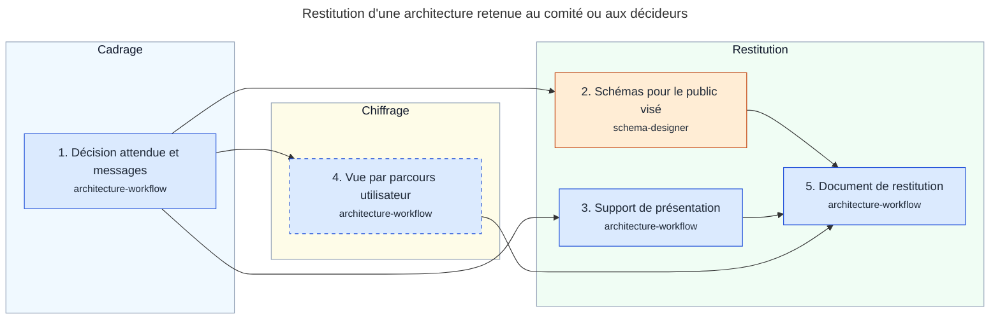

<!-- Fichier généré par scripts/build.py depuis skills/decision-log/workflows/restitution.json : ne pas le modifier à la main. -->

# Restitution d'une architecture retenue au comité ou aux décideurs

Workflow `restitution` : 5 étapes, dont 1 facultatives. Point de départ : dossier validé. [Tous les workflows](README.md).

## À quoi il sert

Workflow de restitution de l'agent architecture-workflow, mené dans un sous-dossier d'un dossier d'architecture aux étapes validées (architecture, cadrage, avant-vente, migration), lisible par un client, un PO ou un BA : synthèse d'une page mise en page par script (décisions attendues, besoin, solution, bénéfices reliés aux exigences, coût par parcours, trois risques, suite), schémas métier (vue d'ensemble, processus) avec les vues techniques en annexe, coût par parcours et découpage en lots en option, glossaire automatique et contrôle de lisibilité (phrases longues, sigles sans définition, jargon), support de présentation et document assemblé ; une porte de revue par étape.

## Ce que le moteur demande au départ

- Le dossier d'architecture à restituer (défaut : le dossier parent, dont les étapes architectures et schémas sont validées) ; restitution menée dans son sous-dossier restitution/
- Le public (comité d'architecture, direction, métiers) et la décision attendue ; sans réponse : comité d'architecture et validation de l'option retenue, hypothèse notée au journal
- Le vault Obsidian qui sert de mémoire partagée (sans réponse : workflow sans vault)

## Déroulé

En bleu, les étapes menées par le moteur `architecture-workflow` ; en orange, celles qu'il confie à un agent spécialisé ; en tirets, les étapes facultatives (l'utilisateur peut les passer). Les étapes sont rangées par zone : lecture du dossier, cadrage, solutioning, chiffrage, restitution. Chaque étape s'arrête pour la revue de l'utilisateur avant la suite.

Étapes prêtes en même temps, menées en parallèle :
- 2. Schémas pour le public visé, 3. Support de présentation, 4. Vue par parcours utilisateur

## Étapes

| Étape | Zone | Niveau | Menée par | Skills | Livrables | Après |
| --- | --- | --- | --- | --- | --- | --- |
| 1. Décision attendue et messages | Cadrage | moyen | `architecture-workflow` | `architecture-dossier`, `diagram-brief` | `donnees/synthese.json`, `synthese.md`, `schemas/briefs/*.json` | début |
| 2. Schémas pour le public visé | Restitution | moyen | `schema-designer` | `diagram-brief`, `excalidraw-diagram`, `process-diagram`, `c4-architecture`, `mermaid-diagram`, `drawio-diagram`, `diagram-export` | `schemas/briefs/*.json`, `schemas/**/*.png` | 1 |
| 3. Support de présentation | Restitution | simple | `architecture-workflow` | `architecture-deck` | `presentation.md` | 1 |
| 4. Vue par parcours utilisateur (facultative) | Chiffrage | simple | `architecture-workflow` | `solution-estimate` | `parcours.md` | 1 |
| 5. Document de restitution | Restitution | simple | `architecture-workflow` | `architecture-dossier` | `glossaire.md`, `restitution.md` | 2, 3, 4 |

### 1. Décision attendue et messages

- **Entrées** : `../donnees/options.json`, `../donnees/decision.json`, `../donnees/exigences.json`, `../adr-architecture.md`, `../chiffrage.md`, `../revue.md`, `../donnees/*.parcours.json`
- **Livrables** : `donnees/synthese.json`, `synthese.md`, `schemas/briefs/*.json`
- **Livrables possibles** : `schemas/decisions/*.json`, `donnees/termes.json`
- **Contrôle** : architecture-dossier : readout.py donnees/synthese.json --journeys ../donnees/*.parcours.json (synthèse d'une page, exigences des bénéfices vérifiées, coût par parcours repris du chiffrage)
- **Contrôle** : architecture-dossier : readability.py synthese.md --terms ../donnees/exigences.json --terms donnees/termes.json (phrases longues, sigles sans définition, jargon)
- **Contrôle** : diagram-brief : brief.py schemas/briefs/<nom>.json --out schemas/decisions/<nom>.json pour chaque schéma prévu

Vous écrivez donnees/synthese.json (--schema de readout.py), dans les mots du public donné à l'ouverture, sans jargon ni nom de produit : summary (la recommandation en une ou deux phrases), decisions (ce que le client doit trancher, avec ses choix et l'échéance), need, solution (et pourquoi : les critères dits dans les mots du métier, pas en scores), benefits (chaque exigence clé reformulée en bénéfice concret, « l'assuré déclare un sinistre en 5 minutes », avec les identifiants qu'elle sert), cost et delay avec leur source, les trois risques majeurs au plus avec leur parade, next_steps. Chaque chiffre et chaque choix vient d'un livrable validé du dossier (donnees/options.json, donnees/decision.json, chiffrage.md, revue.md), cité ; rien n'est recalculé. Avec un chiffrage par parcours, readout.py reprend lui-même le coût total et par parcours : cost ne porte alors que les autres coûts (exploitation). readout.py met en page synthese.md, ne l'écrivez pas. Lisez les avertissements de readability.py : coupez une phrase longue, remplacez un mot de jargon par l'équivalent proposé ; un sigle propre au projet se définit dans donnees/termes.json ({"terms": {"SIGLE": "définition d'une ligne"}}). Un brief par schéma : une vue d'ensemble (audience non technique, kind vue-ensemble), un processus métier (kind processus) pour le parcours principal et, pour un public mixte ou technique seulement, une vue C4 de contexte (vue-c4). À la revue, présenter les décisions attendues et les messages.

### 2. Schémas pour le public visé

- **Entrées** : `schemas/briefs/*.json`, `../donnees/options.json`, `../donnees/decision.json`
- **Livrables** : `schemas/briefs/*.json`, `schemas/**/*.png`
- **Livrables possibles** : `schemas/decisions/*.json`, `schemas/excalidraw/*`, `schemas/process/*`, `schemas/c4/**`, `schemas/mermaid/*`, `schemas/drawio/*`
- **Contrôle** : diagram-brief : brief.py schemas/briefs/<nom>.json --out schemas/decisions/<nom>.json pour chaque schéma (public, destination, type, message, 3 à 7 éléments) : il choisit le format et le skill
- **Contrôle** : selon la décision, une description par schéma dans le dossier de son format : excalidraw-diagram : excalidraw_build.py schemas/excalidraw/<nom>.json --export png ; process-diagram : process_build.py schemas/process/<nom>.json --export png ; c4-architecture : c4_build.py schemas/c4/<nom>.json --out-dir schemas/c4/<nom> --export png ; mermaid-diagram : mermaid_build.py schemas/mermaid/<nom>.json --out schemas/mermaid/<nom>.mmd puis diagram-export : export.py en PNG ; drawio-diagram : drawio_build.py schemas/drawio/<nom>.json --export png
- **Contrôle** : vue C4 de l'option retenue, pour un public mixte ou technique : c4-architecture : c4_build.py --from-options ../donnees/options.json --option <retenue> --out-dir schemas/c4/option --export png (annexe technique du document)
- **Contrôle** : relire chaque PNG une fois

Un à trois schémas métier, chacun avec un seul message. Le brief de chaque schéma (diagram-brief) fixe le format et le skill selon le public et la destination. Pour un client, un PO ou un BA : une vue d'ensemble Excalidraw et le processus métier du parcours principal (process-diagram, couloirs par acteur) ; jamais de schéma d'infrastructure cloud. Une vue C4 de contexte simplifiée seulement pour un public mixte ou technique : elle va en annexe technique du document (schemas/c4/). La description ne reprend que les éléments du brief ; un élément laissé de côté se dit dans left_out. Les constructions sont mécaniques et restent à l'agent du workflow ; un schéma détaillé demandé par l'utilisateur passe à schema-designer. La vue d'ensemble reprend les composants de l'option retenue (../donnees/options.json) regroupés en trois à sept blocs parlants pour le public, sans nom de produit ; la vue C4 se tire de l'option par --from-options.

### 3. Support de présentation

- **Entrées** : `../donnees/options.json`, `../donnees/decision.json`, `../schemas/*.png`
- **Livrables** : `presentation.md`
- **Contrôle** : architecture-deck : deck_build.py .. --out presentation.md (besoin, options, décision, schémas du dossier)
- **Contrôle** : si l'utilisateur veut le .pptx : passer presentation.md à document-publisher (skill externe markdown-to-pptx)

Construit par le script à partir des seuls livrables validés du dossier parent ; ne se réécrit pas. Les messages de synthese.md vont dans l'ordre du discours à la revue, pas dans le fichier. Rien à écrire : démarrer, contrôler et soumettre en un appel (journal.py start DOSSIER presentation --submit).

### 4. Vue par parcours utilisateur

- **Entrées** : `../donnees/chiffrage.parcours.json`
- **Livrables** : `parcours.md`
- **Livrables possibles** : `parcours/*`
- **Contrôle** : solution-estimate : journeys_view.py ../donnees/chiffrage.parcours.json --out parcours.md --export png (coût par parcours en premier, découpage en lots, puis workflow, coût et points d'attention de chaque parcours ; --scenario pour l'hypothèse retenue)

À proposer si le chiffrage déclare ses parcours utilisateurs (../donnees/chiffrage.parcours.json, champ journeys de solution-estimate) ; sans lui, l'étape se saute. Construite par le script : le coût par parcours en premier, le découpage en lots (lots propres et parcours qu'ils servent : la vue que le PO arbitre), puis pour chaque parcours son workflow, son coût et ses points d'attention (risques, hypothèses, dépendances, contrôles du chiffrage), montants repris du chiffrage validé, rien de recalculé. Hypothèse montrée : celle de la recommandation de synthese.md (--scenario), sans IA par défaut. Rien à écrire : démarrer, contrôler et soumettre en un appel (journal.py start DOSSIER parcours --submit).

### 5. Document de restitution

- **Entrées** : `synthese.md`, `schemas/**/*.png`, `parcours.md`, `presentation.md`, `../donnees/exigences.json`, `donnees/termes.json`, `../options.md`, `../adr-*.md`
- **Livrables** : `glossaire.md`, `restitution.md`
- **Contrôle** : architecture-dossier : readability.py synthese.md parcours*.md --terms ../donnees/exigences.json --terms donnees/termes.json --glossary glossaire.md (glossaire des sigles et termes rencontrés, lisibilité contrôlée)
- **Contrôle** : architecture-dossier : dossier_build.py . --template restitution --out restitution.md --strict
- **Contrôle** : si l'utilisateur veut un Word, un PDF ou une page Confluence : passer restitution.md à document-publisher

Assemblage mécanique, en deux niveaux de lecture : pour le métier, la synthèse, le coût par parcours et les lots, les schémas métier et le glossaire ; en annexe technique, les vues C4, les options étudiées et la décision du dossier parent, puis le support et le journal. Le glossaire est tiré par readability.py des sigles et termes rencontrés (dictionnaire livré, glossaire d'donnees/exigences.json, donnees/termes.json) ; un sigle sans définition se définit dans donnees/termes.json avant de soumettre. La publication passe à document-publisher, qui produit les fichiers sans rien mettre en ligne. Rien d'autre à écrire : démarrer, contrôler et soumettre en un appel (journal.py start DOSSIER document --submit).
