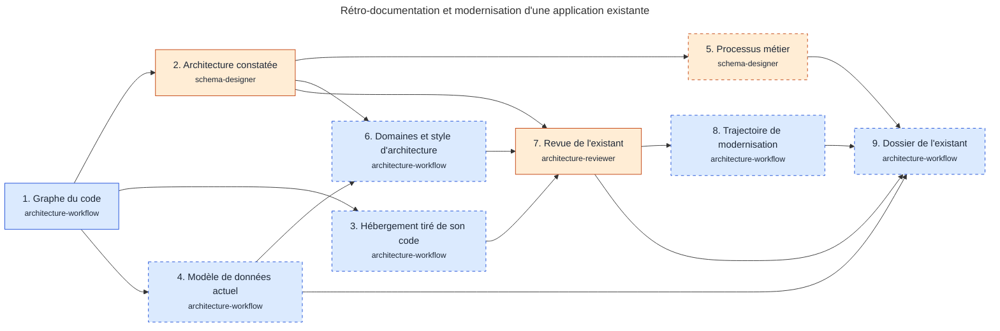

<!-- Fichier généré par scripts/build.py depuis skills/decision-log/workflows/retro-documentation.json : ne pas le modifier à la main. -->

# Rétro-documentation et modernisation d'une application existante

Workflow `retro-documentation` : 9 étapes, dont 6 facultatives. Point de départ : code de l'application. [Tous les workflows](README.md).

## À quoi il sert

Workflow de rétro-documentation de l'agent architecture-workflow : d'une application existante (un ou plusieurs dépôts, lus en local par graphify) à son architecture constatée, au choix son hébergement et son modèle de données tirés de leurs sources et ses processus métier en couloirs, puis au choix le découpage cible en domaines, la revue du code comparé à l'architecture, la trajectoire de modernisation et le dossier de l'existant ; une porte de revue par étape.

## Ce que le moteur demande au départ

- Le vault Obsidian qui sert de mémoire partagée (sans réponse : workflow sans vault)
- Le ou les dépôts de code (dossier code/, ou dépôts de la mission), le dossier du code d'infrastructure s'il n'est pas dans infra/, et le schéma SQL de la base s'il n'est pas dans base/ ; sans réponse : code/ seul, étapes infrastructure et donnees sautées

## Déroulé

En bleu, les étapes menées par le moteur `architecture-workflow` ; en orange, celles qu'il confie à un agent spécialisé ; en tirets, les étapes facultatives (l'utilisateur peut les passer). Chaque étape s'arrête pour la revue de l'utilisateur avant la suite.

Étapes prêtes en même temps, menées en parallèle :
- 2. Architecture constatée, 3. Hébergement tiré de son code, 4. Modèle de données actuel
- 5. Processus métier, 6. Domaines et style d'architecture

## Étapes

| Étape | Niveau | Menée par | Skills | Livrables | Après |
| --- | --- | --- | --- | --- | --- |
| 1. Graphe du code | simple | `architecture-workflow` | aucun | `graphify-out/graph.json` | début |
| 2. Architecture constatée | moyen | `schema-designer` | `c4-architecture` | `donnees/c4.json`, `c4/**/*.png` | 1 |
| 3. Hébergement tiré de son code (facultative) | moyen | `architecture-workflow` | `cloud-architecture` | `schemas/infrastructure.json` | 1 |
| 4. Modèle de données actuel (facultative) | moyen | `architecture-workflow` | `data-model` | `donnees/modele.json`, `modele.md` | 1 |
| 5. Processus métier (facultative) | moyen | `schema-designer` | `process-diagram`, `diagram-export` | `processus/*.json`, `processus/*.drawio`, `processus/*.processus.md` | 2 |
| 6. Domaines et style d'architecture (facultative) | complexe | `architecture-workflow` | `domain-design`, `data-model` | `donnees/domaines.json`, `domaines.md`, `donnees/domaines.styles.json`, `domaines.carte.drawio` | 2, 4 |
| 7. Revue de l'existant | complexe | `architecture-reviewer` | `architecture-review`, `threat-model`, `well-architected-review` | `donnees/revue.json`, `revue.md` | 2, 3, 6 |
| 8. Trajectoire de modernisation (facultative) | moyen | `architecture-workflow` | `transition-roadmap` | `donnees/feuille-de-route.json`, `feuille-de-route.md` | 7 |
| 9. Dossier de l'existant (facultative) | simple | `architecture-workflow` | `architecture-dossier` | `synthese.md`, `dossier-existant.md` | 7, 8, 4, 5 |

### 1. Graphe du code

- **Entrées** : `code/**/*`
- **Livrables** : `graphify-out/graph.json`
- **Contrôle** : graphify (skill externe, analyse locale) : graphify extract code --code-only (un graphe par dépôt pour plusieurs dépôts : graphify-out/<dépôt>/graph.json)

Graphe du code produit en local par graphify, sans lire le code soi-même ; graphify absent : donner sa commande d'installation (contrat shared/external/graphify.contract.json) et s'arrêter. Les dépôts, leur commit et ce qui est exclu (tests, code généré) se notent au journal.

### 2. Architecture constatée

- **Entrées** : `graphify-out/graph.json`, `code/**/*`
- **Livrables** : `donnees/c4.json`, `c4/**/*.png`
- **Contrôle** : c4-architecture : c4_build.py donnees/c4.json --draft graphify-out/graph.json (brouillon), puis c4_build.py donnees/c4.json --out-dir c4 --export png

Partir du brouillon tiré du graphe : nommer chaque conteneur par son rôle, regrouper ou séparer les dossiers, ajouter personnes, bases, files et systèmes externes lus dans la configuration (connexions, clients HTTP, files de messages). Chaque élément ou relation ajouté sans trace dans le code se note au journal comme hypothèse ; à la revue, présenter ce qui est constaté et ce qui est déduit.

### 3. Hébergement tiré de son code

- **Entrées** : `infra/**/*`
- **Livrables** : `schemas/infrastructure.json`
- **Livrables possibles** : `schemas/infrastructure.drawio`, `schemas/infrastructure.drawio.png`
- **Contrôle** : cloud-architecture : iac_import.py infra --out schemas/infrastructure.json, puis cloud_build.py schemas/infrastructure.json --export png

Étape facultative, proposée s'il y a du code d'infrastructure (Terraform, CloudFormation, Bicep, docker-compose, Kubernetes) : l'utilisateur dit s'il la veut (start) ou non (skip). Compléter la description importée : acteurs externes, protocoles et ports, flux que le code ne montre pas ; chacun se note au journal comme hypothèse.

### 4. Modèle de données actuel

- **Entrées** : `base/**/*.sql`
- **Livrables** : `donnees/modele.json`, `modele.md`
- **Livrables possibles** : `donnees/modele.mmd`, `donnees/modele.sql`
- **Contrôle** : data-model : model_import.py base --out donnees/modele.json (brouillon tiré du DDL), puis model_build.py donnees/modele.json

Étape facultative, proposée si le schéma SQL de la base est fourni : l'utilisateur dit s'il la veut (start) ou non (skip). Ne pas réécrire le modèle : relire le brouillon (libellés, données personnelles devinées, clés composées ou absentes, références vers des tables hors du fichier) et noter chaque correction au journal.

### 5. Processus métier

- **Entrées** : `donnees/c4.json`, `graphify-out/graph.json`, `code/**/*`
- **Livrables** : `processus/*.json`, `processus/*.drawio`, `processus/*.processus.md`
- **Livrables possibles** : `processus/*.drawio.png`
- **Contrôle** : process-diagram : process_build.py processus/<processus>.json --export png pour chaque processus (zéro erreur : ni impasse ni décision sans libellé ; fiche du déroulé écrite), puis relire l'image une fois

Étape facultative : l'utilisateur dit s'il la veut (start) ou non (skip). Reconstituer les parcours métier principaux que le code met en œuvre, trois au plus, à partir de l'architecture constatée et des points d'entrée du graphe (contrôleurs, traitements planifiés, files), sans relire tout le code : acteurs et systèmes en couloirs, tâches, décisions avec le libellé de chaque branche. Chaque étape sans trace dans le code se note au journal comme hypothèse.

### 6. Domaines et style d'architecture

- **Entrées** : `donnees/c4.json`, `donnees/modele.json`, `donnees/exigences.json`
- **Livrables** : `donnees/domaines.json`, `domaines.md`, `donnees/domaines.styles.json`, `domaines.carte.drawio`
- **Livrables possibles** : `donnees/domaines.carte.json`, `domaines.carte.drawio.png`, `donnees/modele.json`, `modele.md`, `donnees/modele.mmd`, `donnees/modele.sql`
- **Contrôle** : data-model : model_build.py donnees/modele.json (modèle actuel de l'étape donnees, s'il existe)
- **Contrôle** : domain-design : domain_build.py donnees/domaines.json --export png, avec --vault <vault> --folder <dossier> si le workflow a un vault (zéro erreur ; style recommandé, contextes à extraire et confiance)

Étape facultative, proposée quand l'existant couvre plusieurs domaines fonctionnels ou que la question est de le moderniser (monolithe à découper, microservices à regrouper) : l'utilisateur dit s'il la veut (start) ou non (skip, avec ses mots). Découpage cible tiré des processus métier et du langage, pas des tables ; le modèle actuel (model : donnees/modele.json, étape donnees) mesure le couplage réel du découpage proposé, et les conteneurs du C4 montrent où passe le code aujourd'hui. Un facteur de la grille inconnu (équipes, maturité DevOps, cohérence exigée) se demande une seule fois, sans réponse il reste absent et la confiance baisse. À la revue, présenter le style recommandé, les contextes à extraire, le couplage mesuré et la carte ; le style retenu va dans decision de donnees/domaines.json et se note au journal.

### 7. Revue de l'existant

- **Entrées** : `donnees/c4.json`, `graphify-out/graph.json`, `schemas/infrastructure.json`, `donnees/modele.json`, `donnees/domaines.json`
- **Livrables** : `donnees/revue.json`, `revue.md`
- **Livrables possibles** : `schemas/infrastructure.threats.md`, `schemas/infrastructure.wa.md`
- **Contrôle** : architecture-review : arch_review.py donnees/revue.json, avec --vault <vault> --folder <dossier> si le workflow a un vault (code comparé à l'architecture : règles CODE- ; avec donnees/domaines.json, règles DOM-)
- **Contrôle** : si l'infrastructure est décrite et que l'utilisateur veut les menaces : threat-model : stride.py schemas/infrastructure.json ; well-architected-review : wa_check.py schemas/infrastructure.json --out schemas/infrastructure.wa.md

donnees/revue.json reprend les conteneurs et relations de donnees/c4.json en components et flows, avec le motif code de chaque composant (dossier du brouillon) et code.graph vers graphify-out/graph.json : le script compare le code à l'architecture (dépendance non déclarée, cycle, fichier sans composant). Les scénarios de qualité, risques et dette demandent du jugement et passent à architecture-reviewer. Un écart n'est accepté qu'avec la raison donnée par l'utilisateur, notée au journal.

### 8. Trajectoire de modernisation

- **Entrées** : `revue.md`, `donnees/domaines.json`, `donnees/domaines.styles.json`
- **Livrables** : `donnees/feuille-de-route.json`, `feuille-de-route.md`
- **Livrables possibles** : `donnees/feuille-de-route.csv`, `feuille-de-route-*.png`
- **Contrôle** : transition-roadmap : roadmap_build.py donnees/feuille-de-route.json (zéro erreur ; chemin critique et échéance)

Étape facultative, proposée quand une cible existe (domaines retenus) ou que la revue appelle des corrections lourdes : l'utilisateur dit s'il la veut (start) ou non (skip). Un chantier par contexte à extraire (donnees/domaines.styles.json : du plus autonome au plus couplé), plus les chantiers de dette tirés des constats de la revue et les jalons ; chaque durée prise sans source se note au journal comme hypothèse.

### 9. Dossier de l'existant

- **Entrées** : `c4/**/*.png`, `processus/*.processus.md`, `modele.md`, `revue.md`, `domaines.md`, `feuille-de-route.md`, `journal.md`
- **Livrables** : `synthese.md`, `dossier-existant.md`
- **Livrables possibles** : `plan-actions.md`, `donnees/plan-actions.csv`
- **Contrôle** : architecture-dossier : actions.py . (plan d'actions tiré de la revue)
- **Contrôle** : architecture-dossier : dossier_build.py . --template existant --out dossier-existant.md --strict
- **Contrôle** : si l'utilisateur veut un Word ou un PDF : passer dossier-existant.md à document-publisher

Étape facultative, proposée en dernier : l'utilisateur dit s'il la veut (start) ou non (skip). Écrire synthese.md (une page : périmètre analysé, architecture constatée, avis de la revue, dette et risques principaux, cible et trajectoire si elles sont faites) à partir des rapports des étapes, sans relire les livrables ; le reste est assemblé par le script.

## Mémoire partagée

Fichiers que le moteur reporte dans le vault Obsidian, quand le workflow en a un :

- requirements : `donnees/exigences.json`
