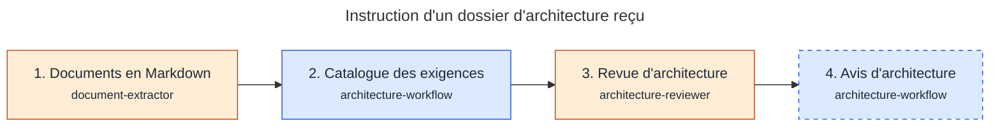

<!-- Fichier généré par scripts/build.py depuis skills/decision-log/workflows/revue-dossier.json : ne pas le modifier à la main. -->

# Instruction d'un dossier d'architecture reçu

Workflow `revue-dossier` : 4 étapes, dont 1 facultatives. Point de départ : documents du projet. [Tous les workflows](README.md).

## À quoi il sert

Pour un comité d'architecture : documents du dossier reçu d'un projet en Markdown, catalogue des exigences, revue d'architecture (scénarios de qualité, risques, compromis, traçabilité) avec avis calculé, puis l'avis d'architecture assemblé ; sans concevoir d'options.

## Ce que le moteur demande au départ

- Le vault Obsidian qui sert de mémoire partagée (sans réponse : workflow sans vault)
- Le dossier du code du projet, si la revue doit comparer le code à l'architecture

## Déroulé

En bleu, les étapes menées par le moteur `architecture-workflow` ; en orange, celles qu'il confie à un agent spécialisé ; en tirets, les étapes facultatives (l'utilisateur peut les passer). Chaque étape s'arrête pour la revue de l'utilisateur avant la suite.

## Étapes

| Étape | Niveau | Menée par | Skills | Livrables | Après |
| --- | --- | --- | --- | --- | --- |
| 1. Documents en Markdown | simple | `document-extractor` | `doc-to-markdown` | `sources/*.md` | début |
| 2. Catalogue des exigences | moyen | `architecture-workflow` | `requirements-catalog` | `donnees/exigences.json`, `exigences.md`, `donnees/exigences.csv` | 1 |
| 3. Revue d'architecture | complexe | `architecture-reviewer` | `architecture-review`, `threat-model`, `well-architected-review` | `donnees/revue.json`, `revue.md` | 2 |
| 4. Avis d'architecture (facultative) | simple | `architecture-workflow` | `architecture-dossier` | `synthese.md`, `dossier-architecture.md` | 3 |

### 1. Documents en Markdown

- **Entrées** : `documents/*`
- **Livrables** : `sources/*.md`
- **Contrôle** : doc-to-markdown : convert.py <documents> --out sources (--triage TRI.json si l'utilisateur veut le tri, voir classify.py --candidates), puis validate.py sources

Documents nommés par l'utilisateur, sinon ceux de documents/, convertis en une commande ; un document déjà en Markdown est copié tel quel dans sources/. Les pages de vision_pages sont transcrites par la vision ; à partir de 5 documents à transcrire, passer la main à document-extractor. Un document écarté se note au journal avec sa raison.

### 2. Catalogue des exigences

- **Entrées** : `sources/*.md`
- **Livrables** : `donnees/exigences.json`, `exigences.md`, `donnees/exigences.csv`
- **Livrables possibles** : `donnees/exigences.candidats.json`, `donnees/exigences.tri.json`
- **Contrôle** : requirements-catalog : req_build.py donnees/exigences.json --candidates, tri des phrases par un sous-agent de niveau simple (donnees/exigences.tri.json), puis req_build.py donnees/exigences.json : zéro erreur et zéro phrase d'exigence non reprise

req_build.py donnees/exigences.json --draft écrit d'abord une exigence par phrase normative (citation exacte, numérotation des documents) ; lire chaque sources/*.md une seule fois pour trier et compléter ce brouillon, en gardant la numérotation des documents quand elle existe, avec le glossaire des termes métier et sigles employés. Chaque exigence déduite, priorité non explicite ou phrase écartée se note au journal.

### 3. Revue d'architecture

- **Entrées** : `sources/*.md`, `donnees/exigences.json`
- **Livrables** : `donnees/revue.json`, `revue.md`
- **Livrables possibles** : `schemas/*.json`, `schemas/*.threats.md`, `schemas/*.wa.md`
- **Contrôle** : architecture-review : arch_review.py donnees/revue.json, avec --vault <vault> --folder <dossier> si le workflow a un vault (avis calculé ; constat de gravité haute traité ou accepté avec la raison de l'utilisateur)
- **Contrôle** : si le dossier décrit une architecture cloud et que l'utilisateur veut les menaces : threat-model : stride.py schemas/architecture.json

Le dossier reçu décrit déjà l'architecture : donnees/revue.json reprend ses composants, couches et flux tels que les documents les donnent (chaque déduction se note au journal comme hypothèse), les exigences d'donnees/exigences.json et les décisions du dossier. Les scénarios de qualité, risques, sensibilités et compromis passent à architecture-reviewer. Aucune option nouvelle n'est conçue : un manque devient un risque ou une réserve de l'avis.

### 4. Avis d'architecture

- **Entrées** : `exigences.md`, `revue.md`, `journal.md`
- **Livrables** : `synthese.md`, `dossier-architecture.md`
- **Livrables possibles** : `plan-actions.md`, `donnees/plan-actions.csv`
- **Contrôle** : architecture-dossier : actions.py . si une revue, des menaces ou une AIPD ont été faites (plan d'actions repris par le dossier)
- **Contrôle** : architecture-dossier : dossier_build.py . --template avis --strict (liens et images vérifiés)
- **Contrôle** : si l'utilisateur veut un Word ou un PDF : passer dossier-architecture.md à document-publisher

Étape facultative : l'utilisateur dit s'il la veut (start) ou non (skip, avec ses mots). synthese.md donne l'objet du dossier, l'avis calculé et ses réserves, et les décisions attendues du comité, à partir du rapport d'arch_review.py.

## Mémoire partagée

Fichiers que le moteur reporte dans le vault Obsidian, quand le workflow en a un :

- requirements : `donnees/exigences.json`
