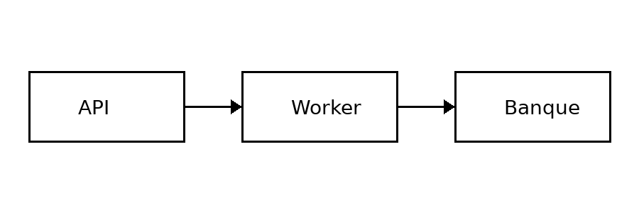

# Portail de déclaration de sinistres

Dossier d'architecture pour le comité de direction.

## Exigences clés

- **2 000 déclarations** par jour, avec des pics après les tempêtes
- **99,5 %** de disponibilité
- **8 000 €** par mois au plus

## Démarche

1. Recueillir les documents du projet
2. Établir le catalogue des exigences
3. Comparer deux options d'architecture
4. Valider le choix en comité

## Options comparées

### Option A : services managés

- Mise à l'échelle automatique
- Coût à l'usage

### Option B : machines virtuelles

- Équipe déjà formée
- Mise à l'échelle manuelle

## Flux de déclaration

## Calendrier

- T1 2027 : cadrage et choix de l'option
- T2 2027 : pilote dans deux régions
- T3 2027 : déploiement national
